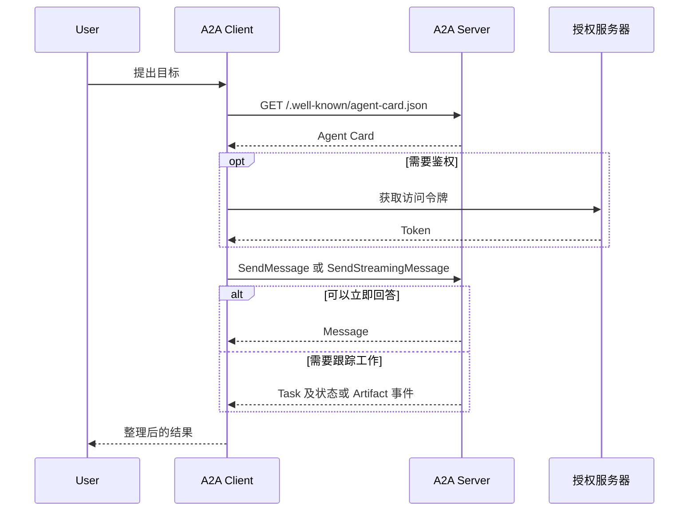

Agent2Agent（A2A）是 AI Agent 之间的开放通信协议。它让由不同团队、框架或厂商实现的 Agent 通过统一的发现方式和消息格式协作，同时保持各自内部的模型、记忆和工具不对外暴露。



## A2A 解决什么问题

如果每个 Agent 都通过定制接口调用另一个 Agent，集成数量增长后就会形成大量点对点适配。A2A 将这类协作抽象为可发现的远端 Agent：

- Agent 通过 Agent Card 声明身份、能力、端点和鉴权要求。
- 调用方通过标准消息发起任务，而不需要了解服务端的内部实现。
- 长任务可以持续上报状态、请求补充输入，或通过流和 Webhook 异步交付结果。
- 文本、文件和结构化数据都使用统一的 `Part` 表达。

## 参与者与请求路径

A2A 交互中有三个核心角色：

| 角色 | 职责 |
|---|---|
| User | 人或上游系统，提出最终目标 |
| A2A Client | 代表 User 发现并调用远端 Agent |
| A2A Server | 对外暴露 A2A 接口的远端 Agent |

一次典型请求依次经过发现、鉴权和消息发送：

鉴权通常走标准 HTTP 机制。凭据放在请求头中，不放进 A2A 消息正文；Agent Card 只声明需要什么鉴权方式，不应包含静态密钥。

## A2A 与 MCP

A2A 和 Model Context Protocol（MCP）解决不同层面的连接问题：

| 协议 | 连接对象 | 典型用途 |
|---|---|---|
| A2A | Agent 与 Agent | 跨团队或组织委派任务、多轮协商、长任务协作 |
| MCP | Agent 与工具或资源 | 查询数据库、调用 API、读取文件 |

可以概括为：MCP 增加单个 Agent 的深度，A2A 扩展 Agent 系统的广度。一个 Agent 内部可以继续使用 MCP 访问工具，同时通过 A2A 把无法在本地完成的目标交给其他 Agent。

## 适用边界

A2A 适合需要发现、长任务、多轮交互或跨系统协作的场景。以下情况通常不需要它：

- 同一个进程内的普通函数调用。
- 稳定、无状态的工具调用，使用函数调用或 MCP 更直接。
- 已经存在明确契约的普通 HTTP API，调用方不需要 Agent 式协商。

下一步阅读[协议模型与任务生命周期](../protocol-model/)，理解 Agent Card、Task、Message 和 Artifact 如何组成完整契约。
