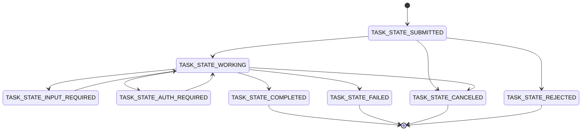

## Agent Card

Agent Card 是 A2A Server 的机器可读“名片”，通常发布在：

```text
https://agent.example.com/.well-known/agent-card.json
```

客户端通过它判断远端 Agent 是否适合当前目标，以及如何建立连接。关键字段包括：

| 字段 | 作用 |
|---|---|
| `name`、`description`、`version` | Agent 的身份和版本 |
| `supportedInterfaces` | 可用的协议绑定、服务 URL 和协议版本 |
| `capabilities` | 是否支持流式、推送通知、Extended Agent Card 等能力 |
| `defaultInputModes`、`defaultOutputModes` | 默认媒体类型 |
| `skills` | 可调用的能力列表 |
| `securitySchemes` | 调用方需要满足的鉴权要求 |

`AgentSkill` 用 `id`、`name`、`description`、`tags`、`examples` 和输入输出模式描述一项能力。客户端应依据技能描述选择 Agent，而不是假设某个具体业务接口一定存在。

公开发现并不只有 Well-Known URI。企业也可以使用中心注册表，或在受控环境里直接配置 Agent Card。注册表没有由协议规定的统一查询 API。

## 核心对象

| 对象 | 含义 |
|---|---|
| `Message` | 一轮通信，包含 `role`、`messageId` 和若干 `Part` |
| `Part` | 统一内容容器，承载 `text`、`url`、`raw` 或 `data` |
| `Task` | 有状态的工作单元，包含状态、历史和 Artifact |
| `Artifact` | Agent 产出的具体交付物，例如文档、图片或结构化数据 |
| `contextId` | 服务端生成，用于关联同一目标下的一组交互和 Task |
| `taskId` | 标识某个具体 Task |

一个 `Part` 必须且只能包含一种内容：文本、外部文件 URL、内联二进制或 JSON 数据。`mediaType`、`filename` 和 `metadata` 提供补充信息。

Agent 对一条消息可以返回无状态 `Message`，也可以创建 `Task`。需要进度、长时间执行、补充输入或取消时使用 Task；简单且立即可完成的交互可以使用 Message。

## 任务状态

Task 一旦进入终止状态就不能重新启动。后续修改或追问要使用相同 `contextId` 创建新 Task，并通过 `referenceTaskIds` 指向旧 Task。



`INPUT_REQUIRED` 和 `AUTH_REQUIRED` 是可恢复的中间状态。`COMPLETED`、`FAILED`、`CANCELED` 和 `REJECTED` 是终止状态。

## 三种交互方式

| 方式 | 客户端行为 | 适用场景 |
|---|---|---|
| 请求/响应与轮询 | 调用 `SendMessage`，必要时用 `GetTask` 查询 | 普通任务或客户端可主动轮询 |
| SSE 流式 | 调用 `SendStreamingMessage` 并持续读取事件 | 需要实时进度或增量结果 |
| 推送通知 | 注册 Webhook，由服务端在重要状态变化时通知 | 极长任务或客户端会断开连接 |

流式事件包括完整 `Task`、`TaskStatusUpdateEvent` 和 `TaskArtifactUpdateEvent`。连接中断后，客户端可用 `SubscribeToTask` 重新订阅仍在执行的 Task。

## 协议绑定

同一个逻辑协议可以用三种标准绑定承载：

- JSON-RPC 2.0 over HTTP，流式部分使用 SSE。
- gRPC。
- HTTP+JSON/REST。

SDK 会根据 Agent Card 的 `supportedInterfaces` 选择实现。本文示例统一使用 JSON-RPC，因为它最容易在本地观察请求和响应，同时仍与官方 Python SDK 保持一致。
