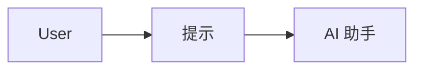
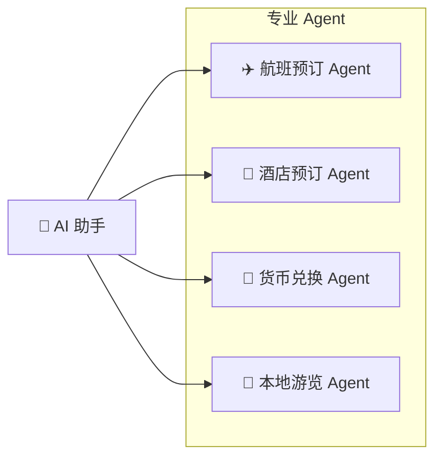
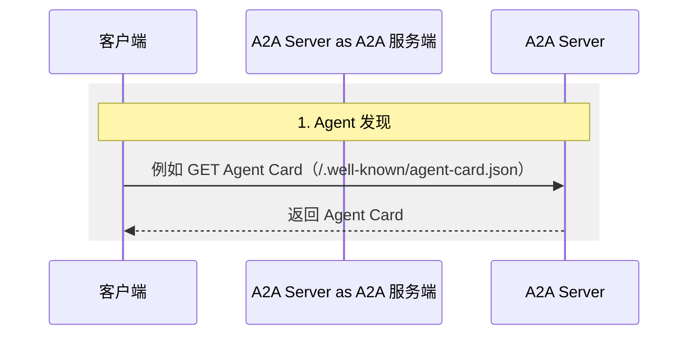
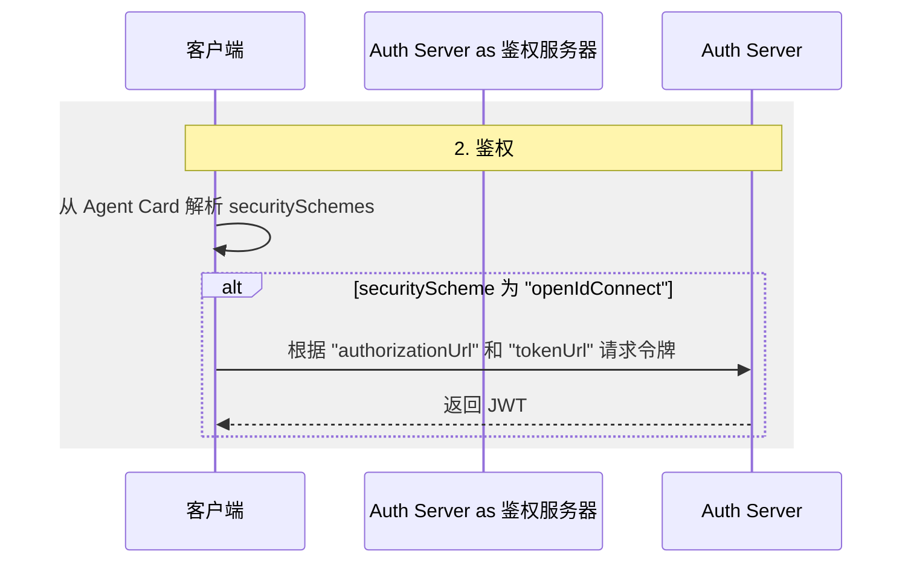
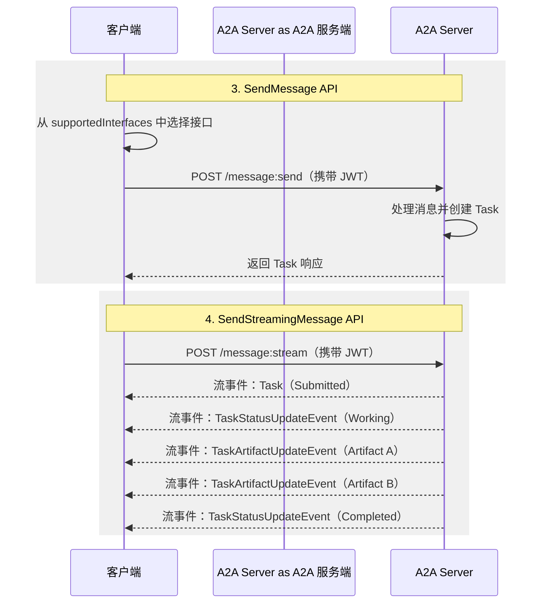

A2A 协议是 AI Agent 之间通信的开放标准。无论 Agent 由哪个框架或厂商构建，它都能为这些 Agent 提供一种共同语言，使它们可以互操作并打破孤岛。Agent 是能够在自身环境中自主行动的问题解决者。借助 A2A，来自不同开发者、框架和组织的 Agent 可以协同工作。

## 为什么使用 A2A 协议

A2A 解决 AI Agent 协作中的关键挑战，为 Agent 的交互提供标准化方式。本节将说明 A2A 解决的问题及其带来的收益。

### A2A 解决的问题

假设用户要求 AI 助手规划一次国际旅行。这项任务需要协调多个专业 Agent，例如：

- 航班预订 Agent
- 酒店预订 Agent
- 本地游览推荐 Agent
- 货币兑换 Agent

如果没有 A2A，集成这些不同的 Agent 会面临若干挑战：

- **Agent 暴露**：为了让 Agent 相互访问，开发者经常把它们包装成工具，就像 Model Context Protocol（MCP）暴露工具一样。但这种方式效率不高：Agent 本来就能直接协商，而将其包装成工具会限制其能力。A2A 让 Agent 保持原貌，无需额外包装。
- **定制集成**：每次交互都需要定制点对点方案，产生大量工程开销。
- **创新缓慢**：每项新集成都需要专门开发，拖慢了创新速度。
- **扩展性问题**：随着 Agent 和交互数量增长，系统会越来越难以扩展和维护。
- **互操作性受限**：这种方式限制互操作性，阻碍复杂 AI 生态系统自然形成。
- **安全缺口**：临时设计的通信方式往往缺少一致的安全措施。

A2A 可以解决这些挑战，让 AI Agent 可靠、安全地互操作。

### A2A 示例场景

下面的示例展示 Agent2Agent（A2A）协议如何帮助 AI Agent 处理复杂交互。

#### 用户的复杂请求

用户与 AI 助手交互，并向它提出一个复杂提示，例如“规划一次国际旅行”。

#### 协作需求

AI 助手收到提示后，发现自己需要调用多个专业 Agent 才能完成请求。这些 Agent 包括航班预订 Agent、酒店预订 Agent、货币兑换 Agent 和本地游览 Agent。

#### 互操作性挑战

核心问题在于：这些 Agent 各自采用定制的开发和部署方式，无法协同工作。

缺少标准化协议的后果是，这些 Agent 无法协作，甚至无法发现彼此具备哪些能力。航班、酒店、货币和游览 Agent 各自处于孤立状态。

#### “使用 A2A”方案

A2A 协议为 Agent 提供相互通信的标准方法和数据结构。无论底层实现如何，这一点都成立。现在，同样的 Agent 可以通过共享协议通信，组成一个互联系统。

AI 助手此时充当编排者。它收集每个支持 A2A 的 Agent 返回的结果，并针对用户提示给出单一的完整旅行计划。

### A2A 的核心优势

在整个 AI 生态系统中实现 A2A 协议可以带来显著优势：

- **安全协作**：如果没有标准，Agent 之间很难保证安全的通信。A2A 使用 HTTPS，并让运行过程保持不透明，因此 Agent 无法看到协作对象的内部运作。
- **互操作性**：A2A 打破 AI Agent 生态系统之间的孤岛。来自不同厂商和框架的 Agent 可以协同工作。
- **Agent 自主性**：借助 A2A，Agent 在协作时可以保留自身能力并保持自主。
- **无需定制集成**：无需构建专门的插件或点对点代码来连接 Agent。同一个协议可以访问运行在本地机器、云端或由厂商托管的 Agent，并连接跨团队、项目和公司的 Agent。团队因此可以专注于 Agent 提供的价值。
- **支持 LRO**：协议支持长时间运行操作（LRO），通过 Server-Sent Events（SSE）和异步执行处理流式任务。

### A2A 的关键设计原则

A2A 的开发遵循以下原则：优先考虑广泛采用、企业级能力和面向未来的适应性。

- **简洁**：A2A 复用 HTTP、JSON-RPC 和 Server-Sent Events（SSE）等现有标准，避免重新发明核心技术，并加快开发者采用的速度。
- **企业就绪**：A2A 满足关键企业需求，在鉴权、授权、安全、隐私、追踪和监控方面遵循标准 Web 实践。
- **异步**：A2A 原生支持长任务，通过流式传输和推送通知等机制，处理 Agent 或用户无法始终保持连接的场景。
- **模态无关**：Agent 可以使用多种内容类型通信，从而支持纯文本之外的丰富、灵活交互。
- **不透明执行**：Agent 协作时不会暴露内部逻辑、记忆或专有工具。交互只依赖已声明能力和共享上下文，从而保护知识产权并提升安全性。

### 理解 Agent 技术栈：A2A、MCP、Agent 框架和模型

A2A 位于更广泛的 Agent 技术栈中，该技术栈包括：

- **A2A**：标准化跨组织和框架的 Agent 间通信。
- **MCP**：将模型连接到数据和外部资源。
- **Agent 框架（例如 LangGraph、CrewAI、ADK）**：提供构建 Agent 的工具包。
- **模型**：Agent 推理的基础，可以是任意大语言模型（LLM）。

*每一层回答不同的问题：框架构建 Agent，MCP 为 Agent 提供上下文，运行时托管 Agent，A2A 则将 Agent 连接到其他 Agent。*

#### A2A 与 MCP

你可能已经了解一些支持 Agent、模型和工具之间交互的协议。Model Context Protocol（MCP）是其中一种正在兴起的标准，重点是将大语言模型（LLM）连接到数据和外部资源。

Agent2Agent（A2A）协议是 AI Agent 之间，尤其是与其他系统中的 Agent 通信时使用的共同语言。A2A 与 MCP 互补：它们覆盖 Agent 交互中不同但相关的部分。

- **MCP 的关注点**：降低 Agent 连接工具和数据的复杂度。工具通常是无状态的，并执行特定、预定义的功能，例如计算器或数据库查询。
- **A2A 的关注点**：让 Agent 以原生方式协作。它们以 Agent（或用户）的身份通信，而不是通过类似工具的方式交互。这可以支持复杂、多轮交互，让 Agent 在其中推理、规划和委派任务。例如，它们可以在下单时协商或请求澄清。

*A2A 跨越 Agent 之间的边界；MCP 留在单个 Agent 内部，将它连接到 API 和企业应用。*

将 Agent 包装成简单工具有其局限：这种方式无法体现 Agent 的完整能力。[Why Agents Are Not Tools](https://discuss.google.dev/t/agents-are-not-tools/192812) 一文探讨了这一区别。

更详细的比较请参阅 [A2A 与 MCP](./a2a-and-mcp/)。

#### A2A 与 Agent 框架

A2A 是面向 Agent 的通信协议，无论各个 Agent 使用什么框架构建，都能实现 Agent 间通信。团队可以使用 LangGraph、CrewAI、ADK 等 Agent 开发工具包和框架构建 Agent，而 A2A 可以让使用其中任意技术构建的 Agent 协同工作。该协议不依赖也不偏向任何单一框架。

### A2A 请求生命周期

一个请求会经过三个阶段、四个主要步骤：Agent 发现、鉴权，以及消息 API（`SendMessage` 和 `SendStreamingMessage`）。下面的图将流程拆分为这三个阶段，并展示客户端、A2A 服务端和鉴权服务器之间的交互。

#### 1. Agent 发现

客户端获取服务端的 Agent Card，以了解其能力和端点。

#### 2. 鉴权

客户端读取 Agent Card 中的安全方案，并在需要时获取令牌。

#### 3. SendMessage 和 SendStreamingMessage API

客户端向服务端端点发送消息：可以使用 `SendMessage` 进行单次请求/响应，也可以使用 `SendStreamingMessage` 获取 Task 更新流。

## 接下来

选择适合你的阅读路径：

- **希望直接动手？** 按照 [Python 教程](https://a2a-protocol.org/latest/tutorials/python/1-introduction/) 构建第一个 Agent。
- **希望掌握基础？** 阅读构成 A2A 协议基础的[核心概念](./key-concepts/)。
- **希望深入研究 A2A 协议？** [A2A 规范](https://a2a-protocol.org/latest/specification/)是所有能力、方法和数据结构的权威来源。

---

原文：[What is A2A?](https://a2a-protocol.org/latest/topics/what-is-a2a/) · [固定源版本](https://github.com/a2aproject/A2A/blob/9fff3e08ab33bb7674e7d98fc7c08ae8592bb4bd/docs/topics/what-is-a2a.md)
