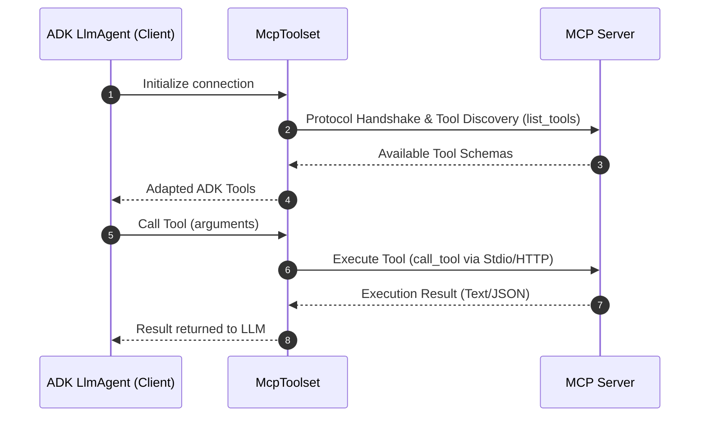

支持版本：Python v0.1.0, Go v0.1.0。

**MCP（MCP）** 是一个用于将生成式 AI 模型连接到外部数据源、工具和系统的开放标准。可以将其视为一种通用的连接机制，简化大型语言模型获取上下文、执行操作以及与各种系统交互的方式。

## 核心架构和概念 {#core-architecture-and-concepts}

MCP 遵循客户端-服务器架构，定义 MCP 服务器如何公开数据或资源、交互式模板或提示，以及可操作的函数或工具，并由 MCP 客户端（可能是 LLM 托管应用程序或 AI Agent）进行消耗。在 ADK 中，你可以使用 McpToolset 类作为 MCP 服务器和 ADK Agent 之间的接口。还可以将 ADK 服务器配置为 MCP 服务器，以供其他客户端系统使用。



## 前提条件和设置规则 {#prerequisites-and-setup-rules}

在开始之前，确保您已完成以下设置：

- **已安装 ADK**：在您的项目环境中完成标准 ADK 设置，并包含 MCP 扩展：`pip install "google-adk[mcp]"`。
- **运行时要求**：Python 3.10 或 Java 17。
- **Node.js 与 `npx`** *(仅限 Python/TS)*：运行 npm 打包的社区 MCP 服务器所需。
- **验证安装**：确认 `adk` 和 `npx` 已在已激活的虚拟环境 PATH 中：


{}

```bash
# Both commands should print the path to the executables.
which adk
which npx
```

{}
{}

```powershell
# Both commands should print the path to the executables.
Get-Command adk
Get-Command npx
```

{}

{}
**部署规则**

部署到生产环境的 Agent**必须在`agent.py`中同步定义`McpToolset`**。动态异步 Agent 初始化仅支持本地调试或自定义独立 Runner。
{}

## 理解用途和集成 {#understand-uses-and-integrations}

主要有三种集成模式。本页面涵盖了直接集成，其他实现方式在各自的页面中详细介绍。

1. **直接 MCP 工具集成**：当 ADKAgent 作为 MCP 客户端使用`McpToolset`时。
2. **Agent 暴露的 MCP 服务器**：当你使用`to_mcp_server`构建一个封装 ADK 工具的 MCP 服务器时。
3. **专用子 Agent 委托**：当 Agent 通过`AgentTool`委托子 Agent 时。

## MCP 实现选项 {#mcp-implementation-options}

当你开始使用 MCP（MCP）和 ADK 进行构建时，这些关键的架构差异将帮助你设计更稳定高效的 Agent。下表可作为比较指南，帮助你构建这些 Agent。| 维度 | [**直接 MCP 工具集成** (`McpToolset`)](#direct-mcp-tool-integration-mcptoolset) | [**Agent 暴露的 MCP 服务器** (`to_mcp_server`)](/docs/adk/components/custom-tools/mcp-tools/agent-as-mcp-server/) | [**专用子 Agent 委派** (`AgentTool`)](/docs/adk/components/custom-tools/mcp-tools/sub-agent-delegation/) |
| :--- | :--- | :--- | :--- |
| **架构** | 提供确定性端点的外部服务器进程或远程服务，适配到主要 `LlmAgent` 工具列表中。 | 独立 ADK Agent 编译到 MCP 服务器中，可由外部客户端（Claude Code、IDE、外部主机）调用。 | 进程内层级 Agent 封装，父 Agent 调用子 `LlmAgent` 作为可调用工具。 |
| **上下文窗口影响** | **高上下文膨胀**：每个工具定义和原始输出，例如：数据库行或文件块，会进入主要 Agent 的历史记录。 | **隔离**：外部调用者仅接收最终聚合的响应文本/块。 | **零上下文膨胀**：中间探索推理、失败的工具调用和大型原始输出保持在子 Agent 循环内隔离。 |
| **AI 模型负载与分层** | 单一模型必须同时理解所有工具架构、验证约束和工作流状态。 | 独立模型推理，仅专注于所封装的任务。 | 支持**模型分层**，例如：`gemini-2.5-pro` 用于协调器，`gemini-2.5-flash` 用于子 Agent 工具执行并具有专用系统指令。 |
| **延迟与令牌成本** | **较低成本 & 可预测延迟**：1 次 LLM 调用   1 次确定性工具调用   1 次响应生成周期。 | 客户端驱动；延迟取决于内部 Agent 的执行深度。 | **较高成本 & 可变延迟**：多次 LLM 调用，子 Agent 推理周期后再返回父 Agent。 |
| **理想用例** | <ul><li>确定性 API 集成：Postgres、BigQuery、GitHub、Google Maps.</li><li>文件系统操作 & 静态资源读取.</li><li>重用标准预构建的社区 MCP 服务器.</li></ul> | <ul><li>向外部 MCP 兼容生态系统暴露复杂的 ADK 多 Agent 能力.</li><li>将 ADK Agent 集成到 IDE、编辑器或 A2A 流水线中.</li></ul> | <ul><li>需要反复试验的多步骤自主工作流。例如：代码调试或研究综合.</li><li>需要隔离角色或专用指令的任务.</li><li>涉及超过 20 个工具的场景，其中模式过载会影响准确性.</li></ul> |

{}
**状态恢复**尽管 ADK Agent 在生命周期事件期间会保留会话状态，但它们在恢复时不会自动重新建立活动的 MCP 连接。Agent 会根据需要重新初始化连接。
{}

### 直接 MCP 工具集成 (McpToolset) {#direct-mcp-tool-integration-mcptoolset}

`McpToolset` 类可以直接添加到您的 Agent 工具列表中；该类可以无缝连接到 MCP 服务器，发现其工具，并使它们可供 Agent 使用。`McpToolset` 管理与 MCP 服务器的连接。构建工具集并不会立即连接；它会在首次使用时打开会话，例如当 Agent 请求其工具时。它还处理 Agent 或进程终止时的优雅连接关闭。
使用 `McpToolset` 将外部 MCP 服务器的工具导入到您的 ADK `LlmAgent` 中。

#### 示例：本地 Stdio 传输 (FileSystem MCP) {#example-local-stdio-transport-filesystem-mcp}

此示例设置了一个连接到本地 MCP 文件系统服务器的 ADK Agent；它在 Agent 的工具列表中直接实例化 McpToolset 以启用文件管理功能。

**步骤 1**. 使用 `McpToolset` 定义您的 Agent：


{}

```python
import os
from google.adk.agents import LlmAgent
from google.adk.tools.mcp_tool import McpToolset
from google.adk.tools.mcp_tool.mcp_session_manager import StdioConnectionParams
from mcp import StdioServerParameters

TARGET_FOLDER = os.path.abspath("./accessible_files")

root_agent = LlmAgent(
    model="gemini-flash-latest",
    name="filesystem_assistant",
    instruction="Help users manage local files.",
    tools=[
        McpToolset(
            connection_params=StdioConnectionParams(
                server_params=StdioServerParameters(
                    command="npx",
                    args=["-y", "@modelcontextprotocol/server-filesystem", TARGET_FOLDER],
                ),
            ),
            # 可选：选择向 Agent 公开的特定工具
            tool_filter=["list_directory", "read_file"],
        )
    ],
)
```

**步骤 2**：打包并运行你的 Agent，使你的 Agent 可以被 ADK 发现并开始与其交互，请按照以下工作流程操作：

  - 启动打包：在与 agent.py 相同的目录下创建一个 `__init__.py` 文件。此步骤是 ADK 识别你的 Agent 所必需的。
  - 启动 Web 界面：

    ```bash
    cd ./adk_agent_samples
    adk web
    ```

- 与 Agent 交互：从下拉菜单中选择 `filesystem_assistant`，并用命令提示 Agent：*列出当前目录中的文件* 或 *another_file.md 的内容是什么？*


{}
{}

```go
package main

import (
    "context"
    "fmt"
    "os/exec"

    "github.com/modelcontextprotocol/go-sdk/mcp"
    "google.golang.org/adk/v2/agent"
    "google.golang.org/adk/v2/agent/llmagent"
    "google.golang.org/adk/v2/model/gemini"
    "google.golang.org/adk/v2/tool"
    "google.golang.org/adk/v2/tool/mcptoolset"
)

func createFilesystemAgent(ctx context.Context) (agent.Agent, error) {
    // 1. 使用 CommandTransport 和 AllowedToolsPredicate 初始化 MCP 工具集
    mcpTools, err := mcptoolset.New(mcptoolset.Config{
        Transport: &mcp.CommandTransport{
            Command: exec.Command("npx", "-y", "@modelcontextprotocol/server-filesystem", "./accessible_files"),
        },
        ToolFilter: tool.AllowedToolsPredicate([]string{"list_directory", "read_file"}),
    })
    if err != nil {
        return nil, fmt.Errorf("failed to create mcp toolset: %w", err)
    }

    // 2. 初始化 Gemini model.LLM 实例
    llm, err := gemini.NewModel(ctx, "gemini-2.0-flash", nil)
    if err != nil {
        return nil, fmt.Errorf("failed to create gemini model: %w", err)
    }

    // 3. 创建返回 agent.Agent 的 LLM Agent
    return llmagent.New(llmagent.Config{
        Name:        "filesystem_assistant",
        Model:       llm,
        Instruction: "Help users manage local files.",
        Toolsets:    []tool.Toolset{mcpTools},
    })
}

func main() {
    ctx := context.Background()
    ag, err := createFilesystemAgent(ctx)
    if err != nil {
        panic(err)
    }
    fmt.Printf("Successfully created agent: %s\n", ag.Name())
}
```

{}


#### 示例：远程 HTTP / SSE 传输（Google 地图基础 Lite） {#example-remote-http--sse-transport-google-maps-grounding-lite}

在开始之前，请按照 [Google 地图基础 Lite](https://developers.google.com/maps/ai/grounding-lite) 的说明，在您的 Google Cloud 项目中启用该服务并生成您的 Maps Platform API 密钥。
与之前的本地流程示例不同，这种模式将您的 Agent 连接到远程托管的 MCP 服务器，使用服务器发送事件（SSE）。它使用 Google 地图基础 Lite 服务来演示如何将身份验证头（例如 API 密钥）传递到可扩展端点。

**步骤 1**：使用 `McpToolset` 定义您的 Agent。


{}

```python
import os
from google.adk.agents import LlmAgent
from google.adk.tools.mcp_tool import McpToolset
from google.adk.tools.mcp_tool.mcp_session_manager import StreamableHTTPConnectionParams

API_KEY = os.getenv("GOOGLE_MAPS_API_KEY")

root_agent = LlmAgent(
    model="gemini-flash-latest",
    name="travel_planner",
    instruction="Plan travel routes and search locations using Google Maps.",
    tools=[
        McpToolset(
            connection_params=StreamableHTTPConnectionParams(
                url="https://mapstools.googleapis.com/mcp",
                headers={
                    "X-Goog-Api-Key": API_KEY,
                    "Content-Type": "application/json",
                    "Accept": "application/json, text/event-stream",
                },
                timeout=5,
                sse_read_timeout=300
            )
        )
    ],
)
```

**第2步**：在运行 `adk web` 之前设置环境变量，在你的终端中设置你的谷歌 API 密钥

  ```bash
  export GOOGLE_MAPS_API_KEY="YOUR_ACTUAL_GOOGLE_MAPS_API_KEY"
  ```

 **步骤 3**：运行 `adk web`：导航到 `mcp_agent` 的上级目录并启动网页界面。
 **步骤 4**：与 UI 交互：
   - 从下拉菜单中选择 `travel_planner`。
   - 尝试以下提示：*我明天会在旧金山。天气怎么样* 或 *在金门公园附近找咖啡店*

 

{}


## 远程 MCP 身份验证和资源访问 {#remote-mcp-authentication-and-resource-access}

本节向您展示如何使用身份验证连接到远程 MCP 服务器，以及如何读取 MCP 服务器公开的 **资源** 数据。当 MCP 服务器需要身份验证时，如通过 Server-Sent Events `SseConnectionParams` 或 Streamable HTTP，`McpToolset` 会自动处理凭证注入和令牌管理。

### 关键身份验证参数 {#key-authentication-parameters}

| 参数 | 类型 | 描述 |
| :--- | :--- | :--- |
| `auth_scheme` | `AuthScheme` | 身份验证策略（例如 `Bearer`, `Basic`, `APIKey`, `OAuth2`）。 |
| `auth_credential` | `AuthCredential` | 密钥凭证负载，例如 API 令牌、OAuth 访问令牌、用户名/密码。 |

ADK 会自动构建所需的 `Authorization` HTTP 头，并在客户端请求期间管理 OAuth 2.0 令牌刷新。

### 配置身份验证 {#configure-authentication}

当 MCP 服务器需要身份验证时，`McpToolset` 会自动处理凭证注入和令牌管理。使用本地 `auth_scheme` 和 `auth_credential` 参数，而不是手动注入 HTTP 头。

*有关通用 ADK 身份验证模式，请参见我们的 [自定义工具身份验证指南](/docs/adk/components/custom-tools/authentication/)*


{}

```python
import os
from google.adk.tools.mcp_tool import McpToolset
from google.adk.tools.mcp_tool.mcp_session_manager import SseConnectionParams

# 通过头部配置承载令牌认证
toolset = McpToolset(
    connection_params=SseConnectionParams(
        url="https://mcp-server.example.com/sse",
        headers={"Authorization": f"Bearer {os.getenv('MCP_AUTH_TOKEN')}"},
        timeout=5,
    )
)
```

{}


## 访问 MCP 资源 {#accessing-mcp-resources}

除了可执行的 **工具** 外，MCP 服务器还可以公开 **资源** 数据文件、数据库记录或 API 上下文数据块。

`McpToolset` 提供了两种核心方法来发现和读取这些数据资源：

### 核心方法 {#core-methods}

* **`list_resources()`**：返回 MCP 服务器公开的所有可用数据资源列表。
* **`read_resource(name)`**：通过资源名称或 URI 获取特定资源的原始内容块、文本或二进制数据。
* **`use_mcp_resources=True`（配置）**：在初始化 `McpToolset` 时，设置此标志会自动为 LLM Agent 配备 `LoadMcpResourceTool`。这允许 Agent 自行动态发现和读取资源，而无需手动程序获取。

#### 试一试 {#try-it-out}


{}

```python
import asyncio

async def fetch_mcp_data(toolset):
    # 1. 在服务器上发现可用资源
    resources = await toolset.list_resources()
    print("Available Resources:", resources)

    # 2. 从特定资源读取内容
    if resources:
        resource_name = resources[0]
        content_blocks = await toolset.read_resource(name=resource_name)
        print(f"Content of {resource_name}:", content_blocks)
```

{}


## 故障排除和最佳实践检查表 {#troubleshooting--best-practices-checklist}

* **安全性与范围**：始终在`McpToolset`中提供`tool_filter=[...]`，以仅向您的 LLM 暴露必要的操作。
* **超时**：在`StdioConnectionParams(timeout=5)`上配置明确的超时，以防止子进程挂起。
* **生命周期清理**：在非`adk web`Runner 中，调用`await toolset.close()`或使用异步上下文管理器优雅地关闭子进程。
* **环境检测**：根据环境变量动态选择连接类型，例如：Cloud Run使用`K_SERVICE`，而本地开发使用Stdio。

### 配置环境感知型连接 {#configure-the-environment-aware-connection}

```python
import os
from google.adk.tools.mcp_tool import McpToolset
from google.adk.tools.mcp_tool.mcp_session_manager import (
    StdioConnectionParams,
    StreamableHTTPConnectionParams,
)
from mcp import StdioServerParameters

if os.getenv("K_SERVICE"):
  # 在生产环境中运行（Cloud Run）
  # 使用可流式 HTTP 进行无状态可扩展性和承载者认证头
  mcp_toolset = McpToolset(
      connection_params=StreamableHTTPConnectionParams(
          url=os.getenv("REMOTE_MCP_URL"),
          headers={"Authorization": f"Bearer {os.getenv('MCP_AUTH_TOKEN')}"},
          timeout=5,
          sse_read_timeout=300,
      )
  )
else:
  # 本地开发中运行
  # 使用标准输入输出子进程 IPC 进行零网络延迟测试
  mcp_toolset = McpToolset(
      connection_params=StdioConnectionParams(
          server_params=StdioServerParameters(
              command="npx",
              args=["-y", "@modelcontextprotocol/server-filesystem", "/tmp"],
          ),
          timeout=5,
      )
  )
```

## 更多资源 {#further-resources}

一旦你了解了基本知识，可以探索[复杂实现和自定义集成的高级用例](/docs/adk/components/custom-tools/mcp-tools/advanced-configuration/)。

---

原文：[Model Context Protocol tools](https://adk.dev/tools-custom/mcp-tools/) · [固定源版本](https://github.com/google/adk-docs/blob/e0bf69f506a609baf0b684f99eb2bacb179e7507/docs/tools-custom/mcp-tools/index.md)
