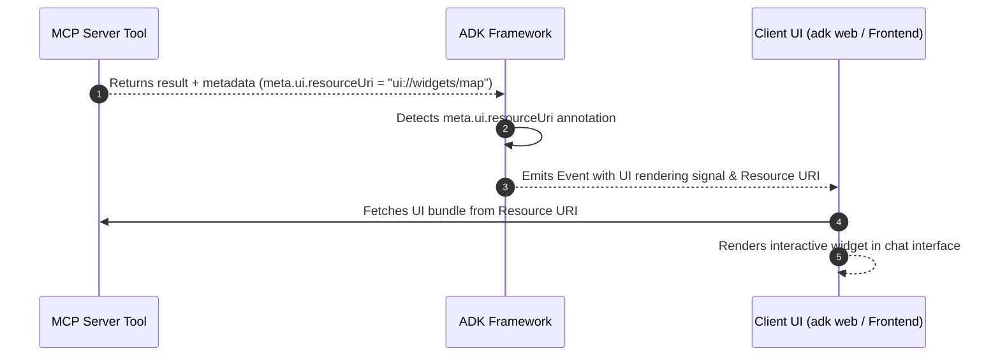

支持版本：Python v0.1.0。

本指南涵盖了 ADK 中 MCP（MCP）的高级集成模式。它提供了用于动态每用户身份验证、人机审批、长期进度跟踪、自定义运行时执行和企业云部署的生产模式。

## 高级配置模式 {#advanced-configuration-patterns}

使用下表选择适合您生产工作负载的配置机制：

| 开发者需求 | 推荐机制 | 主要 API / 参数 | 典型场景 |
| :--- | :--- | :--- | :--- |
| **注入每用户凭证或动态会话令牌** | 动态头提供程序 | `header_provider=...` | 多租户应用，每用户 JWT/OAuth 令牌 |
| **在危险工具调用前需要审批** | 工具确认 | `require_confirmation=...` | 数据库修改、破坏性 shell/文件操作 |
| **为长时间运行的操作流式传输实时进度** | 进度回调与工厂 | `progress_callback=...` | 大型 SQL 查询、网页抓取、数据索引 |
| **在 FastAPI / 后端服务中运行 Agent 而无需 `adk web`** | 程序化 Runner 生命周期 | `Runner`   `await toolset.close()` | 自定义微服务、CLI 工具、工作队列 |
| **解决跨服务器的工具命名冲突** | 工具命名空间与过滤 | `tool_name_prefix`, `tool_filter` | 聚合多个 MCP 服务器（数据库、GitHub） |
| **处理服务器请求的抽样或身份验证挑战** | 双向协议回调 | `sampling_callback`, `elicitation_callback` | 服务器发起的 LLM 生成与身份验证提示 |
| **检查原始 STDERR 诊断流** | 诊断流日志记录 | `errlog=sys.stderr` | MCP 子进程崩溃排查 |
| **在聊天中渲染丰富、交互式视觉部件** | 实验性 UI 渲染 | `meta.ui.resourceUri` | 地图、图表、天气卡或自定义表单 |
| **从 MCP 服务器动态获取 Agent 指令** | 动态指令提供程序 | `McpInstructionProvider` | 通过 MCP 服务器进行集中提示管理 |

## 动态身份验证与每用户头部（`header_provider`） {#dynamic-authentication-and-per-user-headers-headerprovider}

在多租户或面向用户的系统中，将凭证硬编码到连接参数中是不安全的。`McpToolset` 支持 `header_provider`，这是一个异步或同步可调用函数，它接收活动的 `ReadonlyContext` 来在每次工具调用时动态构建身份验证头。

```python
from google.adk.agents import LlmAgent
from google.adk.agents.readonly_context import ReadonlyContext
from google.adk.tools.mcp_tool import McpToolset, StreamableHTTPConnectionParams

async def extract_per_user_headers(context: ReadonlyContext) -> dict[str, str]:
    """Dynamically extracts session state or per-user token on every turn."""
    user_token = context.state.get("user_access_token", "ANONYMOUS_TOKEN")
    return {
        "Authorization": f"Bearer {user_token}",
        "X-User-ID": context.user_id,
        "X-Session-ID": context.session.id,  # Fixed: access session.id
    }

toolset = McpToolset(
    connection_params=StreamableHTTPConnectionParams(
        url="https://mcp-server.example.com/mcp",
        timeout=5,
        sse_read_timeout=300,
    ),
    header_provider=extract_per_user_headers,
)
```

## 人类在环和工具确认（`require_confirmation`） {#human-in-the-loop-and-tool-confirmations-requireconfirmation}

MCP 服务器可能暴露高风险功能，例如：数据库模式修改或记录删除。您可以在整个工具集中的所有工具上全局强制确认，也可以通过检查工具参数的谓词函数有条件地执行确认。

```python
from typing import Any
from google.adk.agents import LlmAgent
from google.adk.tools.mcp_tool import McpToolset
from google.adk.tools.mcp_tool.mcp_session_manager import StdioConnectionParams
from mcp import StdioServerParameters

def should_require_approval(query: str = "", **kwargs) -> bool:
    query_str = str(query).lower()
    destructive_keywords = ["drop", "delete", "truncate", "alter", "update"]
    return any(keyword in query_str for keyword in destructive_keywords)

toolset = McpToolset(
    connection_params=StdioConnectionParams(
        server_params=StdioServerParameters(
            command="npx",
            args=["-y", "@modelcontextprotocol/server-postgres", "postgresql://localhost/db"],
        ),
        timeout=5,
    ),
    require_confirmation=should_require_approval,  # Can also be a boolean (True)
)

root_agent = LlmAgent(
    model="gemini-flash-latest",
    name="db_administrator",
    instruction="Execute database queries safely with explicit approval for mutations.",
    tools=[toolset],
)
```

## 实时进度跟踪 (`progress_callback`) {#real-time-progress-tracking-progresscallback}

长时间运行的 MCP 操作，例如抓取大型网站或培训任务，会通过 `notifications/progress` 通道发送中间进度通知。

### 选项 A：全局回调函数 {#option-a-global-callback-function}
为简单的日志记录或进度报告分配共享回调函数：

```python
async def on_mcp_progress(progress: float, total: float | None, message: str | None) -> None:
    percentage = (progress / total * 100) if total else progress
    print(f"[MCP Progress] {percentage:.1f}% complete: {message or 'Working...'}")

toolset = McpToolset(
    connection_params=...,
    progress_callback=on_mcp_progress,
)
```

### 选项 B：每工具回调工厂（会话感知） {#option-b-per-tool-callback-factory-session-aware}
使用 `ProgressCallbackFactory` 注入具有写入 `ToolContext.state` 权限的特定工具回调：

```python
from google.adk.tools.tool_context import ToolContext

def create_tool_progress_tracker(tool_name: str, callback_context: ToolContext, **kwargs):
    """Generates custom progress handlers and updates active agent session state."""
    async def progress_handler(progress: float, total: float | None, message: str | None):
        callback_context.state[f"{tool_name}_status"] = message
        callback_context.state[f"{tool_name}_progress"] = progress
    return progress_handler

toolset = McpToolset(
    connection_params=...,
    progress_callback=create_tool_progress_tracker,
)
```

## 独立 Runner 执行（`adk web` 外部） {#standalone-runner-execution-outside-adk-web}

在将 ADK Agent 嵌入自定义 FastAPI 应用、后台工作程序或独立 CLI 脚本时，请实例化 `Runner` 并通过 `await toolset.close()` 明确管理生命周期清理。

```python
import asyncio
import os
from google.genai import types
from google.adk.agents import LlmAgent
from google.adk.runners import Runner
from google.adk.sessions import InMemorySessionService
from google.adk.tools.mcp_tool import McpToolset
from google.adk.tools.mcp_tool.mcp_session_manager import StdioConnectionParams
from mcp import StdioServerParameters

async def run_standalone_mcp_agent():
    # 1. 同步定义 McpToolset 和 Agent
    toolset = McpToolset(
        connection_params=StdioConnectionParams(
            server_params=StdioServerParameters(
                command="npx",
                args=["-y", "@modelcontextprotocol/server-filesystem", os.path.abspath("./data")],
            ),
            timeout=5,
        ),
        tool_filter=["list_directory", "read_file"],
    )

    agent = LlmAgent(
        model="gemini-flash-latest",
        name="filesystem_assistant",
        instruction="Assist users with file management.",
        tools=[toolset],
    )

    # 2. 设置会话和 Runner
    session_service = InMemorySessionService()
    session = await session_service.create_session(
        app_name="standalone_mcp_app",
        user_id="user_001",
    )

    runner = Runner(
        app_name="standalone_mcp_app",
        agent=agent,
        session_service=session_service,
    )

    try:
        # 3. 流式执行 agent
        user_message = types.Content(
            role="user",
            parts=[types.Part(text="List the files available in the directory.")],
        )

        async for event in runner.run_async(
            session_id=session.id,
            user_id=session.user_id,
            new_message=user_message,
        ):
            if event.content and event.content.parts:
                for part in event.content.parts:
                    if part.text:
                        print(part.text, end="", flush=True)
    finally:
        # 4. 优雅地终止子进程和网络连接
        print("\nTerminating MCP connection...")
        await toolset.close()

if __name__ == "__main__":
    asyncio.run(run_standalone_mcp_agent())
```

## 名称冲突和工具命名空间（`tool_name_prefix`） {#name-collisions-and-tool-namespacing-toolnameprefix}

当您连接到多个 MCP 服务器时，工具名称如 `query` 或 `search` 可能会发生冲突。使用 `tool_name_prefix` 可自动为发现的工具创建命名空间：

```python
from google.adk.tools.mcp_tool import McpToolset
from google.adk.tools.mcp_tool.mcp_session_manager import StdioConnectionParams
from mcp import StdioServerParameters

postgres_toolset = McpToolset(
    connection_params=StdioConnectionParams(
        server_params=StdioServerParameters(
            command="npx",
            args=["-y", "@modelcontextprotocol/server-postgres", "postgresql://localhost/db"],
        )
    ),
    tool_name_prefix="pg_",  # Generates pg_query, pg_list_tables
)

github_toolset = McpToolset(
    connection_params=StdioConnectionParams(
        server_params=StdioServerParameters(
            command="npx",
            args=["-y", "@modelcontextprotocol/server-github"],
        )
    ),
    tool_name_prefix="gh_",  # Generates gh_search_repositories, gh_create_issue
)
```

## 双向协议钩子：采样与引导 {#bi-directional-protocol-hooks-sampling-and-elicitation}

MCP 支持双向交互，其中服务器可以请求客户端执行操作：
- **采样 (`sampling_callback`)**：允许 MCP 服务器请求 ADK 主机生成 LLM 完成。
- **引导 (`elicitation_callback`)**：允许 MCP 服务器请求带外用户交互或身份验证流程。

```python
from mcp import SamplingCapability
from google.adk.tools.mcp_tool import McpToolset

async def handle_server_sampling(params):
    """Processes server-initiated LLM generation requests."""
    return {
        "role": "assistant",
        "content": {"type": "text", "text": "Generated response from ADK"},
    }

async def handle_server_elicitation(params):
    """Handles authentication or interactive challenges from the server."""
    print(f"Elicitation requested: {params}")
    return {"action": "approved"}

toolset = McpToolset(
    connection_params=...,
    sampling_callback=handle_server_sampling,
    sampling_capabilities=SamplingCapability(),
    elicitation_callback=handle_server_elicitation,
)
```

## 诊断日志记录和错误流 (`errlog`) {#diagnostic-logging-and-error-streams-errlog}

默认情况下，MCP 子进程错误会记录到标准错误。您可以将 STDERR 流重定向到外部文件或诊断缓冲区以进行根本原因调试：

```python
import sys
from google.adk.tools.mcp_tool import McpToolset

error_file = open("mcp_server_errors.log", "a")
try:
    toolset = McpToolset(connection_params=..., errlog=error_file)
    # 运行 Agent...
finally:
    await toolset.close()
    error_file.close()
```

## 渲染交互式 UI 小部件 {#render-interactive-ui-widgets}

标准的 MCP 工具返回纯文本或 JSON 输出。此功能使 MCP 工具能够在聊天界面中直接返回丰富的、交互式的可视化小部件，例如地图、图表或表单。



### 工作原理 {#how-it-works}

1. **工具注册**：MCP 工具在其模式定义元数据中声明一个 UI 资源链接，在 `tools/list`: `meta.ui.resourceUri = "ui://widgets/weather-card"` 期间。
2. **ADK 检测**：ADK 读取模式定义以检测 `meta.ui.resourceUri`，并知道该工具支持交互式 UI。
3. **客户端显示**：在工具执行时，ADK 会向网页 UI（`adk web` 或自定义前端）发出信号，以获取 UI 资源并渲染交互式组件，而不是纯文本。

```python
from mcp import types as mcp_types
from mcp.server.lowlevel import Server

app = Server("weather-mcp-server")

@app.list_tools()
async def list_mcp_tools() -> list[mcp_types.Tool]:
  """Declares the tool and attaches UI rendering metadata."""
  return [
      mcp_types.Tool(
          name="get_weather",
          description="Get weather forecast for a city.",
          inputSchema={
              "type": "object",
              "properties": {"city": {"type": "string"}},
              "required": ["city"],
          },
          meta={"ui": {"resourceUri": "ui://widgets/weather-card"}},
      )
  ]

@app.call_tool()
async def call_mcp_tool(name: str, arguments: dict) -> list[mcp_types.Content]:
  """Executes the tool and returns standard text/data content."""
  if name == "get_weather":
    city = arguments.get("city", "Unknown")
    return [
        mcp_types.TextContent(
            type="text", text=f"Weather in {city}: 72°F Sunny"
        )
    ]
  return [
      mcp_types.TextContent(type="text", text=f"Unknown tool: '{name}'")
  ]
```

## 使用 `McpInstructionProvider` 的动态指令 {#dynamic-instructions-with-mcpinstructionprovider}

支持版本：Python v1.18.0。

要在 Python 中动态管理 Agent 指令，请使用 `McpInstructionProvider`。该类从 MCP (MCP) 服务器获取 Agent 指令。

使用 MCP 服务器连接参数和要获取的提示名称初始化 `McpInstructionProvider`。将此实例传递给 `LlmAgent` 的 `instruction` 参数：

```python
from google.adk.agents import LlmAgent, McpInstructionProvider
from google.adk.tools.mcp_tool import SseConnectionParams

# 定义 MCP 连接参数。
mcp_connection_params = SseConnectionParams(
    url="https://mcp.example.com",
    headers={"Authorization": "Bearer YOUR_MCP_API_KEY"},
)

# 创建指令提供者的实例。
instruction_provider = McpInstructionProvider(
    connection_params=mcp_connection_params,
    prompt_name="my-agent-prompt",
)

# 在 Agent 中使用指令提供者。
my_agent = LlmAgent(
    model="gemini-2.0-flash",
    name="my_mcp_agent",
    instruction=instruction_provider,
)
```

{}
**注意**

从 MCP 服务器获取的指令直接控制您的 Agent 行为。仅连接您信任的 MCP 服务器，并保护连接参数中使用的任何凭据。
{}

## 下一步 {#next-steps}

* 返回 [MCP 概述](/docs/adk/components/custom-tools/mcp-tools/) 进行基本设置。
* 探索 [自定义功能工具](/docs/adk/components/custom-tools/function-tools/overview/) 以使用进程内 Python 工具。
* 阅读 [ADK 部署指南](/docs/adk/run/deployment/) 以获取完整的云配置选项。

---

原文：[Advanced MCP configuration](https://adk.dev/tools-custom/mcp-tools/advanced/) · [固定源版本](https://github.com/google/adk-docs/blob/e0bf69f506a609baf0b684f99eb2bacb179e7507/docs/tools-custom/mcp-tools/advanced.md)
