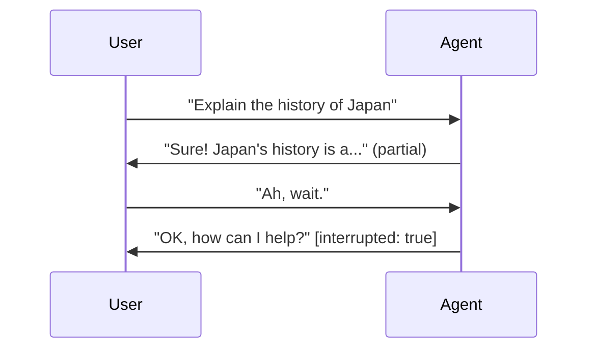

支持版本：Python v0.5.0。

ADK 是构建实时和语音 Agent 的框架。实时 Agent 保持开放的双向接口
与用户的连接：用户和
Agent 可以同时说话、听和回应，用户可以中断
特工说话中句话时，人们在真实对话中互相打断的方式。活特工
接受文字、音频和视频输入，并以文字或语音回复。

实时 Agent 是 ADKAgent，使用与你相同的 Agent、工具和会话抽象构建
其他地方都用。你描述 Agent 的行为;ADK 管理实时连接，
工具执行和会话状态都在下面。你可以在
[Gemini Live API](https://ai.google.dev/gemini-api/docs/live-api) 带有 [语音转语音](/docs/adk/components/live-and-voice-agents/architectures/speech-to-speech/)
建模，或链式语音转文本，任何文本 LLM 和文本转语音，在[级联流水线](/docs/adk/components/live-and-voice-agents/architectures/cascade/)中进行。

  

    

      <iframe src="https://www.youtube-nocookie.com/embed/vLUkAGeLR1k" title="ADK Gemini Live API Toolkit in 5 minutes" frameborder="0" allow="accelerometer; autoplay; clipboard-write; encrypted-media; gyroscope; picture-in-picture; web-share" allowfullscreen></iframe>
    

  

  

    

      <iframe src="https://www.youtube-nocookie.com/embed/Hwx94smxT_0" title="Shopper's Concierge 2 Demo" frameborder="0" allow="accelerometer; autoplay; clipboard-write; encrypted-media; gyroscope; picture-in-picture; web-share" allowfullscreen></iframe>
    

  

## 打造活人经纪人 {#build-live-agents}

## 开始吧 {#which-kind-of-streaming-do-you-need}

搭建你的第一个在线客服，在浏览器里与它对话。

[选择架构](/docs/adk/components/live-and-voice-agents/architectures/choose-an-architecture/)

## 建筑 {#why-build-live-agents-on-adk}

功能页面大致按你需要的顺序排列。

[配置](/docs/adk/components/live-and-voice-agents/building/configuration/)

## 制作 {#demos-and-resources}

带一个`adk web`以外的真人经纪人。

[支持型号](/docs/adk/components/live-and-voice-agents/supported-models/)

## 你需要哪种类型的直播？

“流媒体”在 ADK 中涵盖了三个不同内容，选错其中一个是常见的
令人困惑的来源。

| |它的作用 |用户可以打断吗？|在 |在哪里 |
|:---- |:---- |:---- |:---- |:---- |
|**服务器端流式传输** |服务器到客户端的单向流，就像实时传输一样。|不 |你推送的是仪表盘或动态更新，而不是对话。|ADK 之外 |
|**令牌级流媒体** |文本一字一句地送到，但你要等它完成后再发送更多。|不 |你想要的是响应式文字聊天。|`StreamingMode.SSE` （[Configuration](/docs/adk/components/live-and-voice-agents/building/configuration/#streamingmode-bidi-or-sse)） |
|**双向流媒体** |双方通过一个开放连接同时说话、收听和响应。|**是的** |你正在建立语音或视频对话。|`runner.run_live()` — 这些页面 |

这些页面大约在第三行。

## 为什么在 ADK 上构建实时 Agent

Live API 提供了流式协议。ADK 提供了其周围的一切，因此你可以编写 Agent 行为，而不是流式基础设施。

| | 原始 Live API (`google-genai`) | ADK |
|---|---|---|
| 工具执行 | 手动 | [自动](/docs/adk/components/live-and-voice-agents/building/tools/#automatic-tool-execution) |
| 重连 | 手动 | [自动会话恢复](/docs/adk/components/live-and-voice-agents/building/sessions/#session-resumption) |
| 事件 | 自定义结构 | [统一事件模型](/docs/adk/components/live-and-voice-agents/building/events/) |
| 异步协调 | 手动 | [`LiveRequestQueue`   `run_live()`](/docs/adk/components/live-and-voice-agents/building/sessions/) |
| 会话持久化 | 手动 | [SQL, Agent 平台, 内存](/docs/adk/components/agent-context/conversational-context/) |
| 多 Agent | 不可用 | [工作流, 子 Agent, 转移](/docs/adk/components/live-and-voice-agents/building/workflows/) |

## 演示和资源

## LensMosaic：使用实时 AI 的视觉购物

融合实时摄像头输入、语音和产品发现。将摄像头对准任何物体

[来源](https://github.com/kazunori279/lens-mosaic)

## 双向流的视觉指南

覆盖流式工作原理以及如何构建交互式的图表和插图

[阅读文章](https://medium.com/google-cloud/adk-bidi-streaming-a-visual-guide-to-real-time-multimodal-ai-agent-development-62dd08c81399)

## Google ADK Gemini 实时 API

使用实时 Agent 进行音视频实时传输，并提供基于 Python 服务器的示例

[阅读文章](https://medium.com/google-cloud/google-adk-vertex-ai-live-api-125238982d5e)

---

原文：[Live and voice agents](https://adk.dev/live/) · [固定源版本](https://github.com/google/adk-docs/blob/e0bf69f506a609baf0b684f99eb2bacb179e7507/docs/live/index.md)
