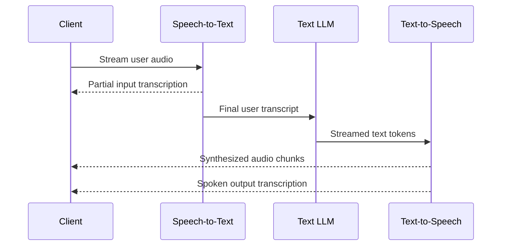

支持版本：Python v2.13.0。

在级联架构中，`CascadeLive` 将流式语音转文本 (STT)、文本推理大型语言模型 (LLM) 和流式文本转语音 (TTS) 链接起来。音频依次通过三个阶段：语音识别将用户音频转录为文本，LLM 对文本进行推理并调用工具，语音合成将流式文本回复转换为音频。

你可以在 Agent 的 `model` 参数上配置 `CascadeLive`，这样你的 [`Runner.run_live()`](/docs/adk/components/live-and-voice-agents/building/sessions/#the-run_live-loop) 循环、请求队列、工具、回调和工作流保持不变。同一个 Agent 也可以与 `Runner.run_async()` 一起用于仅文本请求，跳过语音阶段并直接调用内部文本模型。

有关与原生语音到语音模型的比较，请参见 [选择语音架构](/docs/adk/components/live-and-voice-agents/architectures/choose-an-architecture/)。

## 配置级联 Agent {#configure-a-cascaded-agent}

将 `CascadeLive` 实例传递给 `Agent`，并配备文本 LLM、语音转文本提供商和文本转语音提供商：


{}

`GeminiSTT` 和 `GeminiTTS` 在 `google.adk.live` 中使用你现有的 Google 凭据，无需额外安装软件包。

```python
from google.adk.agents import Agent
from google.adk.live import CascadeLive, GeminiSTT, GeminiTTS
from google.genai import types

root_agent = Agent(
    name="voice_assistant",
    model=CascadeLive(
        model="gemini-3.8-flash",
        stt=GeminiSTT(),
        tts=GeminiTTS(speech_config="Kore"),
    ),
    instruction=(
        "You are a voice assistant. Keep answers to one or two short "
        "sentences and end every sentence with punctuation. Write numbers, "
        "symbols, and abbreviations as spoken words."
    ),
    tools=[...],
    generate_content_config=types.GenerateContentConfig(
        thinking_config=types.ThinkingConfig(
            thinking_level=types.ThinkingLevel.LOW
        ),
    ),
)
```

{}
{}

安装 ElevenLabs 插件 (`pip install "google-adk[elevenlabs]"`) 并在你的环境中设置 `ELEVENLABS_API_KEY`。

```python
from google.adk.agents import Agent
from google.adk.integrations.eleven_labs import ElevenLabsSTT, ElevenLabsTTS
from google.adk.live import CascadeLive
from google.genai import types

root_agent = Agent(
    name="voice_assistant",
    model=CascadeLive(
        model="gemini-3.8-flash",
        stt=ElevenLabsSTT(),
        tts=ElevenLabsTTS(),
    ),
    instruction=(
        "You are a voice assistant. Keep answers to one or two short "
        "sentences and end every sentence with punctuation. Write numbers, "
        "symbols, and abbreviations as spoken words."
    ),
    tools=[...],
    generate_content_config=types.GenerateContentConfig(
        thinking_config=types.ThinkingConfig(
            thinking_level=types.ThinkingLevel.LOW
        ),
    ),
)
```

{}

Agent 上的两个设置直接影响语音延迟和合成质量：

- **最小化模型思考**：模型思考在发出第一个响应标记之前进行，并直接增加到首次音频时间。请在 `generate_content_config` 中设置较低的思考级别（或在使用标记预算的模型上设置为零思考预算）。
- **提示句子标点并避免缩写**：内置 TTS 提供者会在句子边界处分割文本，因此第一句在 LLM 完整回复之前就开始播放。第一句中的缩写，如 `Dr. Smith`，可能触发提前分割，而未加标点的输出会在播放开始前缓冲更长时间。

使用 `adk web` 运行 Agent，或使用 [`Runner.run_live()`](/docs/adk/components/live-and-voice-agents/building/sessions/#the-run_live-loop) 驱动它。提供了一个同时使用 Gemini 和 ElevenLabs 语音提供者的完整可运行示例，在 [`cascade` sample](https://github.com/google/adk-python/tree/main/contributing/samples/live/cascade) 中可获取。

## 工作原理 {#how-it-works}



### 字幕和轮次检测 {#captions-and-turn-detection}

- **实时字幕是替换而非追加**：当用户讲话时，中间转录会通过 `event.input_transcription` 到达。与逐词增量输出的本地音频模型不同，级联模式下的每次中间更新都会保留到目前为止的完整话语假设，因此你的客户端应替换显示的字幕，而不是追加。
- **自定义词汇和客户端控制的语音活动检测（VAD）**：服务器端语音活动检测默认启用。要提供领域词汇或从客户端控制轮次边界（例如按键通话）使用 `GeminiSTT`，可以传递 `audio_transcription_config`，或者禁用自动活动检测，并调用 [`send_activity_start()` 和 `send_activity_end()`](/docs/adk/components/live-and-voice-agents/building/sessions/#liverequestqueue):

```python
from google.adk.live import GeminiSTT
from google.genai import types

stt = GeminiSTT(
    audio_transcription_config=types.AudioTranscriptionConfig(
        language_codes=["en-US"],
        custom_vocabulary=["Cymbal Direct", "Altostrat"],
    ),
    activity_detection=types.AutomaticActivityDetection(disabled=True),
)
```

### 打断会将历史记录截断到用户实际听到的内容 {#barge-in-truncates-history-to-what-the-user-heard}

TTS 提供商的语音合成速度通常比实时播放快，因此当用户在回复过程中打断时，客户端缓冲区中通常还会保存用户尚未听到的音频。

当发生打断时，`CascadeLive` 会停止合成和 LLM 生成，触发打断事件以便客户端停止播放，并估算客户端实际播放了多少音频。只有用户实际听到的词会被保存到会话历史和最终的 `output_transcription` 中，因此后续轮次不会引用未发音的文本。

## 自定义语音转换 {#custom-speech-transforms}

要集成其他语音提供商或检查阶段之间的文本，可从 `google.adk.live` 子类化 `LiveIngress`（用于语音转文本）或 `LiveEgress`（用于文本转语音）：

- `LiveIngress` 读取传入的音频流，并生成 speech-start、partial-transcript 和 turn-finished 事件（`UserSpeechStarted`、`PartialTranscript`、`UserTurnFinished`）。
- `LiveEgress` 读取流式 LLM 文本增量，并生成合成的音频块及已发音的转录事件（`AudioChunk`、`AgentSpokenOutput`），直到完成或取消。

因为 LLM 输出在合成之前是纯文本，所以你可以包装任何 `LiveEgress` 来在生成单个音频帧之前编辑或转换文本。

```python
import asyncio
from typing import AsyncGenerator, AsyncIterator
from google.adk.live import EgressEvent, LiveEgress

class RedactingTTS(LiveEgress):
    """Redacts sensitive patterns from streamed LLM text before synthesis."""

    def __init__(self, inner_tts: LiveEgress, redact_fn):
        self._tts = inner_tts
        self._redact = redact_fn

    async def __call__(
        self, text: AsyncIterator[str], *, cancel: asyncio.Event
    ) -> AsyncGenerator[EgressEvent, None]:
        async def sanitized_text() -> AsyncGenerator[str, None]:
            async for delta in text:
                yield self._redact(delta)

        async for event in self._tts(sanitized_text(), cancel=cancel):
            yield event
```

## 注意事项和限制 {#considerations-and-limitations}

- **基于静音的轮次检测**：服务器端 VAD 会在静音阈值后结束用户轮次，因此长时间的句中停顿可能会将一次发言分成两轮。可以在 STT 提供商处调整静音阈值，或使用客户端控制的活动信号。
- **在同步工具执行期间避免说话**：如果用户在同步工具调用仍在运行时结束发言，新用户轮次会落在工具调用和其响应之间，导致该会话中的后续模型请求失败。
- **客户端回声消除**：使用浏览器或硬件声学回声消除 (AEC)，或佩戴耳机，以避免扬声器输出被麦克风作为伪用户中断拾取。

---

原文：[Cascaded architecture](https://adk.dev/live/architectures/cascade/) · [固定源版本](https://github.com/google/adk-docs/blob/e0bf69f506a609baf0b684f99eb2bacb179e7507/docs/live/architectures/cascade.md)
