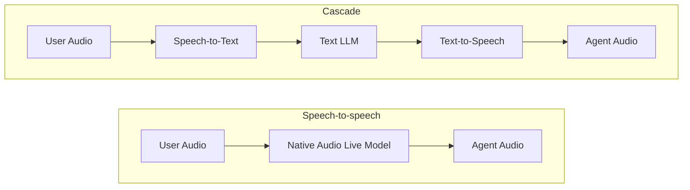

支持版本：Python v2.13.0。

ADK 在 `Runner.run_live()` 下支持两种语音架构：

- **[Speech-to-speech](/docs/adk/components/live-and-voice-agents/architectures/speech-to-speech/)**：单一原生音频模型通过 Gemini Live API 端到端处理语音输入、推理和语音输出。当延迟最低、语音情绪或实时视频输入最重要时效果最佳。
- **[Cascade](/docs/adk/components/live-and-voice-agents/architectures/cascade/)**：按顺序串联语音转文本（STT）、任何文本推理 LLM 以及文本转语音（TTS）。当前沿文本推理、模块化语音提供者或预合成文本控制最重要时效果最佳。

这两种架构都使用相同的 ADK 运行时。您的会话循环、请求队列、事件流、工具、回调和工作流保持不变，切换架构仅更改您 Agent 上的 `model`：


{}

```python
from google.adk.agents import Agent

root_agent = Agent(
    name="voice_assistant",
    model="gemini-live-2.5-flash-native-audio",
    instruction="You are a helpful voice assistant.",
    tools=[...],
)
```

{}
{}

```python
from google.adk.agents import Agent
from google.adk.live import CascadeLive, GeminiSTT, GeminiTTS

root_agent = Agent(
    name="voice_assistant",
    model=CascadeLive(
        model="gemini-3.8-flash",
        stt=GeminiSTT(),
        tts=GeminiTTS(speech_config="Kore"),
    ),
    instruction="You are a helpful voice assistant.",
    tools=[...],
)
```

{}

## 架构比较 {#architecture-comparison}



| 维度 | 语音对语音 | 级联 |
| :--- | :--- | :--- |
| **端到端延迟** | 最低（单模型处理） | 中等（通过流式处理和句子预取重叠串行阶段） |
| **推理模型** | 原生音频实时模型 only ([支持的模型](/docs/adk/components/live-and-voice-agents/supported-models/)) | 任何文本大语言模型（Gemini Flash、Gemini Pro 或第三方模型） |
| **语音提供商** | 内置 Gemini 实时语音 | 模块化（Gemini、ElevenLabs 或自定义 STT/TTS 提供商） |
| **语音细微差别** | 直接听到语调和情感；原生韵律 | STT 将语音转换为文本；TTS 按句子合成 |
| **视频输入** | 支持（实时摄像头和屏幕帧） | 不支持（仅音频和文本） |
| **文本安全措施** | 与音频生成同时筛查转录 | 阶段间有完整文本边界；可在合成前检查或修改文本 |
| **仅文本执行 (`run_async`)** | 不支持 | 支持（直接使用内部文本大语言模型） |
| **SDK 支持** | Python, Java | Python（实验性） |

---

原文：[Choose a voice architecture](https://adk.dev/live/architectures/) · [固定源版本](https://github.com/google/adk-docs/blob/e0bf69f506a609baf0b684f99eb2bacb179e7507/docs/live/architectures/index.md)
