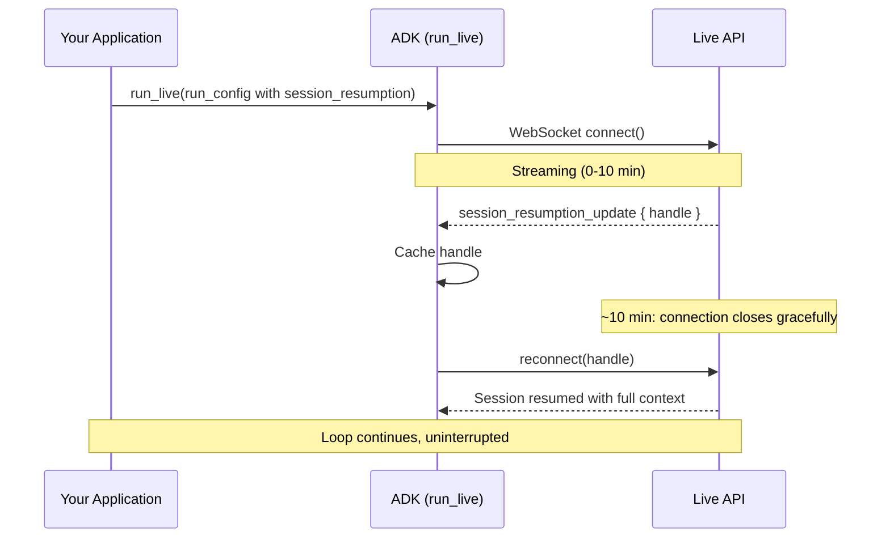

支持版本：Python v0.1.0。

实时 Agent 是指在用户说话、倾听、中断和保持沉默时，连接保持打开的 Agent。

实时 Agent 使用与任何 ADK Agent 相同的 `Session`、`SessionService` 和状态模型，这些在 [会话上下文 ](/docs/adk/components/agent-context/conversational-context/) 中都有涵盖。实时会话增加的是一个*连接*：它可能会断开、超时，或持续存在于模型的上下文窗口之外。有关从该连接*回传*的数据，请参见 [事件 ](/docs/adk/components/live-and-voice-agents/building/events/)；有关定义其行为的设置，请参见 [配置 ](/docs/adk/components/live-and-voice-agents/building/configuration/)。

## 设置实时应用程序 {#set-up-a-live-application}

实时应用程序有两类对象：一种是在启动时创建一次并在每个会话中重复使用的，另一种是每个会话中都新创建的。

**创建一次，到处复用：**

- **`Agent`**：你的模型、工具和指令。无状态且可复用。
- **`SessionService`**：存储对话历史，以便会话在重新连接和重启后仍能继续。
- **`Runner`**：驱动 Agent 并生成事件的运行时。

```python
import os
from google.adk.agents import Agent
from google.adk.runners import Runner
from google.adk.sessions import InMemorySessionService
from google.adk.tools import google_search

APP_NAME = "live-agent"

agent = Agent(
    name="google_search_agent",
    model=os.getenv("DEMO_AGENT_MODEL", "gemini-live-2.5-flash-native-audio"),
    tools=[google_search],
    instruction="You are a helpful assistant that can search the web.",
)

runner = Runner(
    app_name=APP_NAME,
    agent=agent,
    session_service=InMemorySessionService(),
)
```

`InMemorySessionService` 在进程停止时会丢失状态。对于生产环境，请使用 `DatabaseSessionService`（SQLite、PostgreSQL 或 MySQL）或 `VertexAiSessionService`（在 Google Cloud 上托管）。请参阅 [Session services](/docs/adk/components/agent-context/conversational-context/)。

**为每个会话创建：**

- 一个 [`Session`](#adk-session-vs-live-api-session)，在循环运行前获取或创建。
- 一个 [`RunConfig`](/docs/adk/components/live-and-voice-agents/building/configuration/)，可以因用户而异（语音、转录、限制）。
- 一个 [`LiveRequestQueue`](#liverequestqueue)，用于发送用户输入的通道。

```python
from google.adk.agents.live_request_queue import LiveRequestQueue
from google.adk.agents.run_config import RunConfig
from google.genai import types

# 获取或创建处理新对话和重新连接。
session = await session_service.get_session(
    app_name=APP_NAME, user_id=user_id, session_id=session_id
)
if not session:
    await session_service.create_session(
        app_name=APP_NAME, user_id=user_id, session_id=session_id
    )

run_config = RunConfig(
    response_modalities=["AUDIO"],
    session_resumption=types.SessionResumptionConfig(),
)

live_request_queue = LiveRequestQueue()
```

`user_id` 和 `session_id` 是你定义的任意字符串；如果你传递 `session_id=None`，ADK 会生成一个 UUID。在调用 `run_live()` 使用相同标识符之前，必须存在会话，否则 `run_live()` 会引发 `SessionNotFoundError`，这是 `ValueError` 的一个子类。使用 `Runner(..., auto_create_session=True)` 构造 Runner，以便 ADK 在缺少会话时创建它，而不是引发异常。

{}
**每个会话一个队列**

不要在会话之间重复使用 `LiveRequestQueue`。关闭信号会保留在队列中并会延续，破坏下一个会话。每次调用 `run_live()` 时都要创建一个新的队列。
{}

## LiveRequestQueue {#liverequestqueue}

[`LiveRequestQueue`（官方英文）](https://adk.dev/api-reference/python/google-adk.html/#google.adk.agents.LiveRequestQueue) 是你向 Agent 发送消息的通道。每条消息都是 `LiveRequest`，一个包含不同类型输入的单一容器：

```python title='Reference: LiveRequestQueue'
class LiveRequest(BaseModel):
    content: Optional[Content] = None            # Text and structured data
    blob: Optional[Blob] = None                  # Audio/video bytes
    activity_start: Optional[ActivityStart] = None  # Manual turn start
    activity_end: Optional[ActivityEnd] = None      # Manual turn end
    audio_stream_end: bool = False               # No more audio is coming
    close: bool = False                          # Graceful termination
    partial: bool = False                        # Content does not end the turn
    state_delta: Optional[dict[str, Any]] = None # Session state to apply
```

`content` 和 `blob` 是互斥的。请使用便捷方法，而不是自己构建 `LiveRequest` 对象；它们会设置正确的字段并确保你遵守该约束。

| 方法 | 发送内容 | 模式 |
|--------|-------|------|
| `send_content(content)` | 文字，作为单独的回合 | 回合制；触发响应 |
| `send_realtime(blob)` | 音频、图像或视频字节 | 连续流式传输 |
| `send_activity_start()` / `send_activity_end()` | 手动回合边界 | 仅在禁用自动语音活动检测时 |
| `close()` | 终止信号 | 结束会话 |

```python
from google.genai import types

# 文字转换。
live_request_queue.send_content(types.Content(parts=[types.Part(text=user_text)]))

# 音频片段（连续流式传输）。
live_request_queue.send_realtime(
    types.Blob(mime_type="audio/pcm;rate=16000", data=audio_data)
)
```

对于音频、图像和视频格式，请参见 [音频和视频](/docs/adk/components/live-and-voice-agents/building/audio-and-video/)。有关使用活动信号进行手动轮次控制，请参见 [语音活动检测](/docs/adk/components/live-and-voice-agents/building/configuration/#voice-activity-detection-vad)。

{}
**每次调用发送一个文本部分**

每次 `send_content()` 调用只发送一个文本 `Part`。某些实时模型将多部分 `Content` 视为对话起始（历史初始化），而不是需要响应的轮次，因此每次调用只发送一个部分可以保持不同模型间的一致行为。
{}

### 并发性和顺序 {#concurrency-and-ordering}

`LiveRequestQueue` 包装了一个 `asyncio.Queue`，带来三个后果：

- **发送方法是同步的。** 它们在底层调用 `put_nowait()`，因此从不阻塞，也不需要 `await`。
- **交付是 FIFO 且不合并的。** 请求按发送顺序到达模型，每次调用一个。
- **队列是无限的。** 如果发送速度超过模型处理速度，内存会增加，而不会施加回压，因此在高频音频或视频发送时，请自行限制发送速率。

在异步上下文中创建队列，以便它绑定到运行 `run_live()` 的事件循环。`asyncio.Queue` 在单个事件循环线程中可安全并发访问；如果从另一个线程发送，请使用 `loop.call_soon_threadsafe()`。

## run_live() 循环 {#the-runlive-loop}

[`run_live()`（官方英文）](https://adk.dev/api-reference/python/google-adk.html/#google.adk.runners.Runner.run_live) 是一个异步生成器。它在生成 `Event` 对象的瞬间就会 yield，这中间没有缓冲或轮询，同时你可以通过队列并发发送新的输入。正是这种并发性使得中断成为可能：Agent 可以在说话的同时，用户开始打断说话。

```python title='Reference: Runner.run_live()'
async for event in runner.run_live(
    user_id=user_id,
    session_id=session_id,
    live_request_queue=live_request_queue,
    run_config=run_config,
):
    await websocket.send_text(event.model_dump_json(exclude_none=True, by_alias=True))
```

当你调用 `run_live()` 时，它会打开实时 API 连接，在循环运行时双向流传输，并在你调用 `live_request_queue.close()` 时关闭连接。有关它生成的事件类型以及如何处理这些事件，请参见 [Events](/docs/adk/components/live-and-voice-agents/building/events/)。

### 当 run_live() 退出时 {#when-runlive-exits}

| 退出条件 | 触发器 | 是否优雅 |
|---|---|---|
| 手动关闭 | `live_request_queue.close()` | 是 |
| 工作流完成 | 实时工作流中的最后一个 Agent 调用 `task_completed()` | 是 |
| 会话超时 | 达到实时 API 时长限制（未压缩） | 连接关闭 |
| 提前退出 | 调用上下文中设置了 `end_invocation`，例如由返回内容的 `before_agent_callback` 设置 | 是 |
| 错误 | 连接失败或未处理的异常 | 否 |

会话结束时，无论是否发生错误，都应始终调用 `close()`。跳过此步骤会导致实时 API 没有优雅的终止信号，这可能会产生“僵尸”会话，这些会话会占用你的 [并发会话配额](#concurrent-sessions)，直到它们超时。

```python
try:
    await asyncio.gather(upstream_task(), downstream_task())
except WebSocketDisconnect:
    pass  # Client disconnected normally.
finally:
    live_request_queue.close()  # Always close the queue.
```

循环内的错误处理，请参见 [Error events](/docs/adk/components/live-and-voice-agents/building/events/#handling-errors)。有关完整的上游/下游服务器模式，请参见 [Custom server](/docs/adk/components/live-and-voice-agents/production/build-a-custom-server/)。

### 保存到会话的内容 {#what-gets-saved-to-the-session}

当 `run_live()` 退出时，只有部分事件会持久化到 ADK `Session`：

- **已保存：**最终（非部分）转录、使用元数据、函数调用及响应，以及大多数控制事件。音频文件仅在 [`save_live_blob`](/docs/adk/components/live-and-voice-agents/building/configuration/#save_live_blob) 是 `True`] 时保存。
- **临时：**原始音频字节（`inline_data`）和部分转录，用于实时播放和显示，但不存储。

## ADK 会话 vs 实时 API 会话 {#adk-session-vs-live-api-session}

两个不同的概念共享“会话”一词：

- **ADK `Session`**（由 `SessionService` 管理）是持久化的对话存储。它可在多次 `run_live()` 调用和应用重启之间保持。
- **实时 API 会话**（由实时 API 后端管理）是一个临时的流式上下文，仅在循环运行时存在。

当 `run_live()` 启动时，ADK 会从 ADK `Session` 加载历史记录，用它初始化一个新的实时 API 会话，并在事件发生时更新 ADK `Session`。当循环结束时，实时 API 会话被销毁，而 ADK `Session` 被保留。下一次调用会从存储的历史记录重建实时 API 会话。这种区分使得对话可以在网络中断和重启后继续进行。

在传输层，另一项区别对可靠性很重要：

- **连接** 是 ADK 与实时 API 之间的 WebSocket 链接，它可能超时。
- **会话** 是对话上下文，它可以跨多个连接存在，通过 [session resumption](#session-resumption) 实现。

### 平台限制 {#platform-limits}

两个后端都限制了连接时长、会话时长和并发会话数。具体数值因后端而异，并会随时间变化，所以 [Supported models](/docs/adk/components/live-and-voice-agents/supported-models/#platform-limits-and-quotas) 将其统一记录。

其中两项限制会影响代码编写。[Context window compression](#context-window-compression) 提升了会话时长限制，并且并发会话上限是你在 [Concurrent sessions](#concurrent-sessions) 中设计的依据。

## 会话恢复 {#session-resumption}

实时 API 在大约 10 分钟后会关闭每个 WebSocket 连接。[Session resumption](https://ai.google.dev/gemini-api/docs/live-api/session-management#session-resumption) 可在连接之间迁移对话，使其超过时间限制继续进行。启用它后，**ADK 会为你处理所有重连**，缓存恢复句柄，检测连接关闭，并在后台重新连接。你的 `run_live()` 循环将继续不间断地生成事件。

```python
from google.genai import types

run_config = RunConfig(session_resumption=types.SessionResumptionConfig())
```

ADK 仅管理 ADK 与 Live API 的连接。您的应用程序仍然拥有自己的客户端连接（例如，用户到您服务器的 WebSocket）以及任何客户端重新连接逻辑。

ADK 的重新连接方式：

1. Live API 发送 `session_resumption_update` 消息；ADK 缓存最新的句柄。
2. 在达到限制之前，Live API 可能会发送 `go_away` 警告；ADK 会在断开之前重新连接，因此交接是无缝的。
3. 当连接正常关闭时，ADK 的循环会使用缓存的句柄重新连接，且会话会以完整上下文继续。



{}
**重新连接尝试次数已上限**

ADK 最多重试 **5 次连续** 重新连接
([`DEFAULT_MAX_RECONNECT_ATTEMPTS`](https://github.com/google/adk-python/blob/main/src/google/adk/flows/llm_flows/base_llm_flow.py))。
计数器在每次成功重新连接时重置，因此长时间对话仅限于五次*连续失败*，而不是总共五次重新连接。ADK 仅在存在恢复句柄时重试；如果未启用 `session_resumption`，第一次断开就会直接通过 `run_live()` 传播，您的应用程序必须处理它。
{}
仅在短会话（少于 10 分钟）、无状态请求-响应交互或每次运行新会话有助于调试的开发环境中跳过恢复。

## 上下文窗口压缩 {#context-window-compression}

长会话会遇到两个限制：会话持续时间上限，以及模型的上下文窗口（因模型而异）。
[上下文窗口压缩](https://ai.google.dev/gemini-api/docs/live-api/session-management#context-window-compression)解決了这两个问题。当令牌数量超过阈值时，它会使用滑动窗口压缩较早的对话历史，同时保留最近的回合完整。**启用它可以消除会话持续时间的限制。** 其权衡：较早的上下文将成为摘要，而非逐字历史。

```python
from google.genai import types
from google.adk.agents.run_config import RunConfig

# 对于一个128k上下文的模型。
run_config = RunConfig(
    context_window_compression=types.ContextWindowCompressionConfig(
        trigger_tokens=100000,  # Start compressing near ~78% of the window.
        sliding_window=types.SlidingWindow(
            target_tokens=80000,  # Compress down to ~62%, keeping recent turns.
        ),
    )
)
```

将 `trigger_tokens` 设置为模型上下文窗口的约 70-80% 以保留空间，
将 `target_tokens` 设置为 60-70%，以便每次压缩都能释放足够的空间用于多个轮次。请根据您自己的对话模式进行测试。当会话必须超过平台限制或可能超过令牌限制时，启用压缩；对于短会话或需要精确回忆早期轮次的情况，请关闭压缩。

## 并发会话 {#concurrent-sessions}

每个用户都需要自己的实时 API 会话，并且两个后端都对并发会话数设有限制。您的并发会话上限是同时在线用户的硬性上限。有关当前上限以及如何申请提高，请参见 [Supported models](/docs/adk/components/live-and-voice-agents/supported-models/#platform-limits-and-quotas)。

针对上限进行设计：

- **每个用户一个会话** 是默认且正确的选择，只要高峰并发在配额内。
- **会话池**（通过队列分配的一组固定会话）在高峰并发超出配额时可以保持在配额内，但会增加等待时间。释放时重置每个会话的状态，以防会话在用户之间泄露。

无论哪种方式，请自己统计活动会话，并在平台处理之前排队或拒绝新连接。配额拒绝会表现为连接失败，这比显示可见的队列位置体验更差。

---

原文：[Sessions for live agents](https://adk.dev/live/sessions/) · [固定源版本](https://github.com/google/adk-docs/blob/e0bf69f506a609baf0b684f99eb2bacb179e7507/docs/live/sessions.md)
