页面使用 Mermaid 代码围栏描述图表，并由 [Pele](https://pele.run/) 渲染为 SVG。下面按 Pele 官方兼容清单展示 Mermaid 12.1 的全部内建图类型；每节先给出源码，再展示实际渲染结果。

## 渲染方式

代码块继续使用 `mermaid` 语言标记，但站点使用 Pele 将 Mermaid 语法渲染为 SVG。Pele 只在包含 `mermaid` 代码块的页面加载。

图表会自动适配内容宽度；较宽或较长的图表被缩小时，右上角会显示放大、缩小和重置按钮。主题使用 CSS 变量控制背景、文字、节点、边框和连线颜色，切换明暗主题时图表无需重新渲染。

Pele 使用自己的布局引擎，因此节点尺寸、间距和连线路径可能与 Mermaid 原生渲染不同。不支持 ZenUML、其他外部 Mermaid 插件、HTML 标签，以及 `click` 语句中的 JavaScript 回调。

## 流程图

```markdown
flowchart LR
    A[Markdown] --> B[Goldmark]
    B --> C[Hugo]
    C --> D[HTML]
```

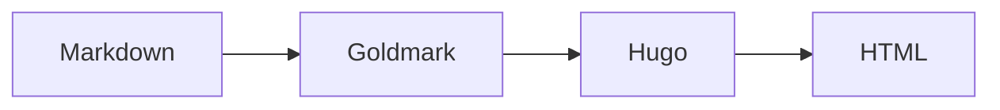

## 泳道图

```markdown
swimlane-beta LR
    subgraph Customer
        request[提出问题]
    end
    subgraph Support
        answer[处理问题]
    end
    request --> answer
```

```mermaid
swimlane-beta LR
    subgraph Customer
        request[提出问题]
    end
    subgraph Support
        answer[处理问题]
    end
    request --> answer
```

## 时序图

```markdown
sequenceDiagram
    participant Browser
    participant Hugo
    participant GitHubPages

    Browser->>Hugo: 请求内容
    Hugo-->>Browser: 返回静态 HTML
    Browser->>GitHubPages: 获取资源
    GitHubPages-->>Browser: 返回 JS/CSS
```

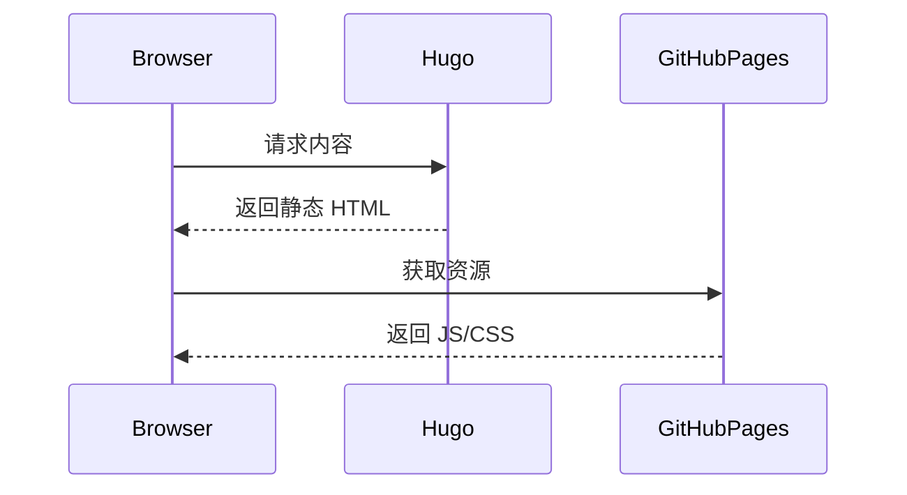

## 类图

```markdown
classDiagram
    class Animal {
        +String name
        +move()
    }
    class Bird {
        +fly()
    }
    Animal <|-- Bird
```

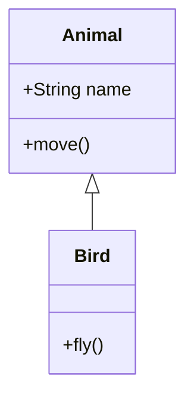

## 状态图

```markdown
stateDiagram-v2
    [*] --> Draft
    Draft --> Review
    Review --> Published
    Published --> Updated
    Updated --> Published
```

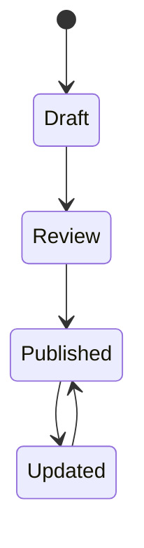

## 实体关系图

```markdown
erDiagram
    CUSTOMER ||--o{ ORDER : places
    ORDER ||--|{ LINE_ITEM : contains
    CUSTOMER {
        string name
    }
```

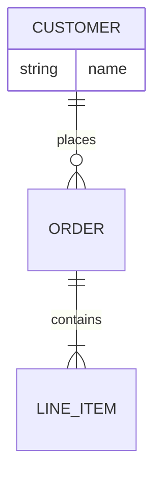

## 甘特图

```markdown
gantt
    title 发布计划
    dateFormat YYYY-MM-DD
    section 构建
        编写文档 :a1, 2026-01-01, 3d
        审阅 :after a1, 2d
```

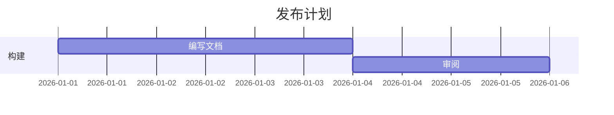

## Git 图

```markdown
gitGraph
    commit id: "init"
    branch feature
    commit id: "feat"
    checkout main
    merge feature id: "merge"
```

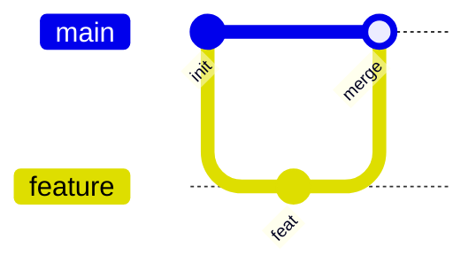

## 饼图

```markdown
pie title 文档格式使用率
    "Markdown" : 55
    "YAML" : 30
    "TOML" : 15
```

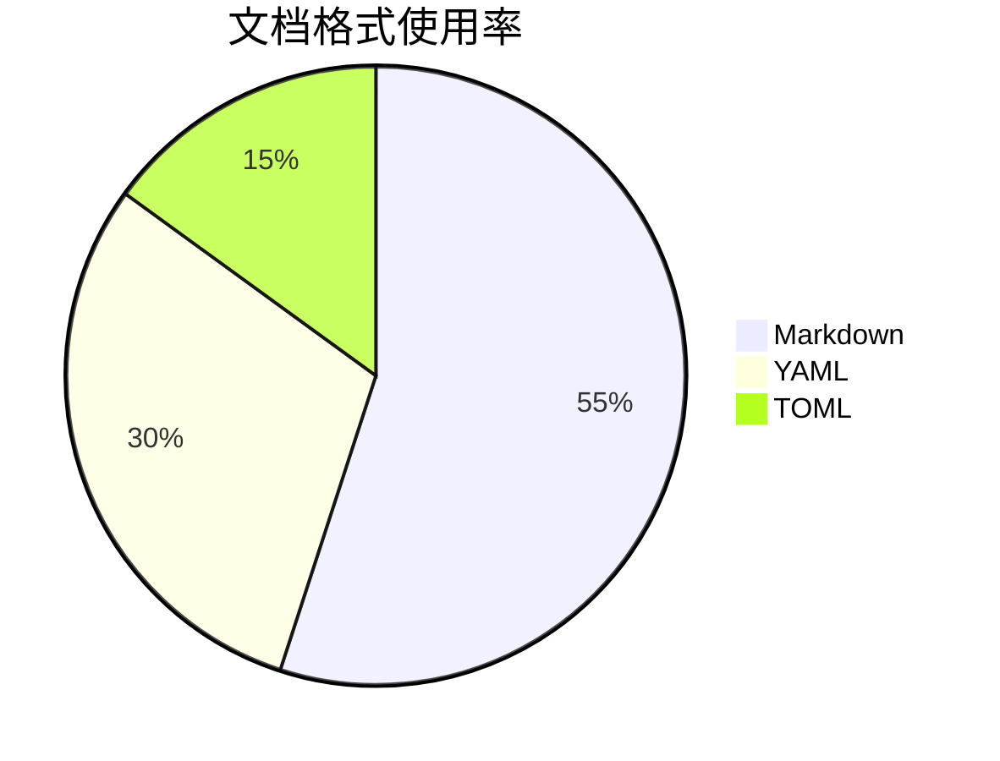

## 思维导图

```markdown
mindmap
    root((BookStack))
        Markdown
            Mermaid
        Hugo
            Pele
```

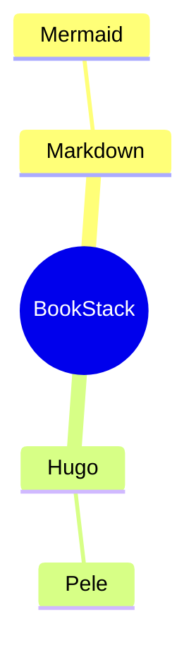

## 看板

```markdown
kanban
    todo[待办]
       write[编写文档]
    doing[进行中]
       verify[验证图表]@{ assigned: 'Rainux', priority: 'High' }
    done[已完成]
       replace[替换渲染器]
```

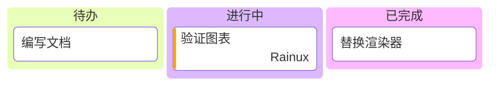

## 时间线

```markdown
timeline
    title Hugo 构建流程
    section 内容
        Markdown : 编写页面
    section 构建
        Hugo : 生成 HTML
        Pele : 浏览器渲染图表
```

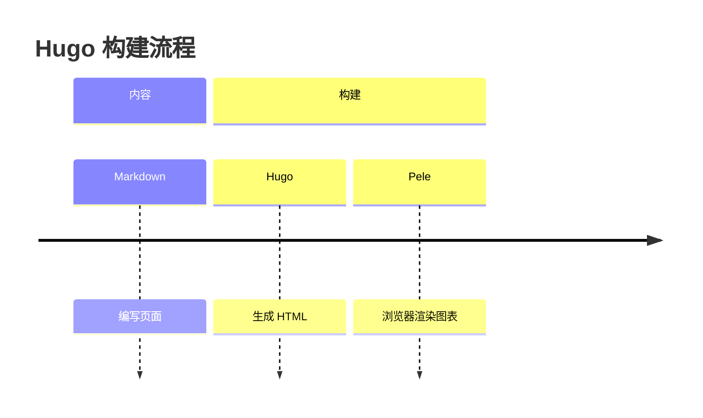

## 用户旅程

```markdown
journey
    title 阅读文档
    section 浏览
        打开页面: 5: Reader
        查找图表: 4: Reader
    section 查看
        放大图表: 5: Reader
```

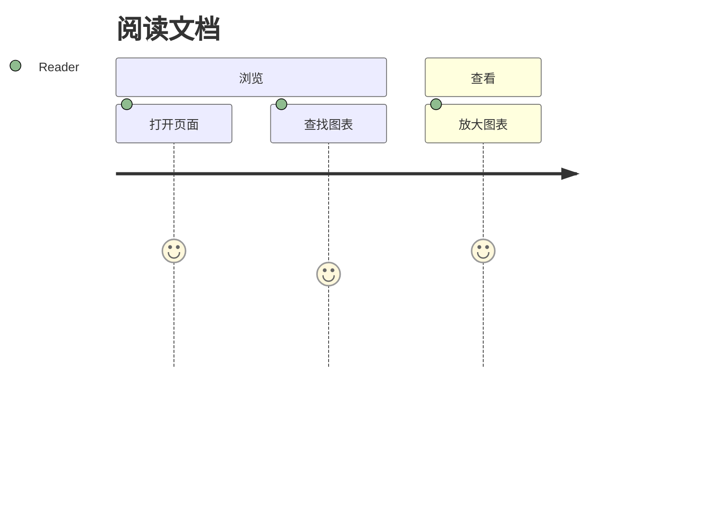

## 象限图

```markdown
quadrantChart
    title 改进优先级
    x-axis 低投入 --> 高投入
    y-axis 低影响 --> 高影响
    quadrant-1 立即处理
    quadrant-2 重点规划
    quadrant-3 暂缓
    quadrant-4 快速完成
    Mermaid 支持: [0.25, 0.9]
    图表缩放: [0.35, 0.7]
```

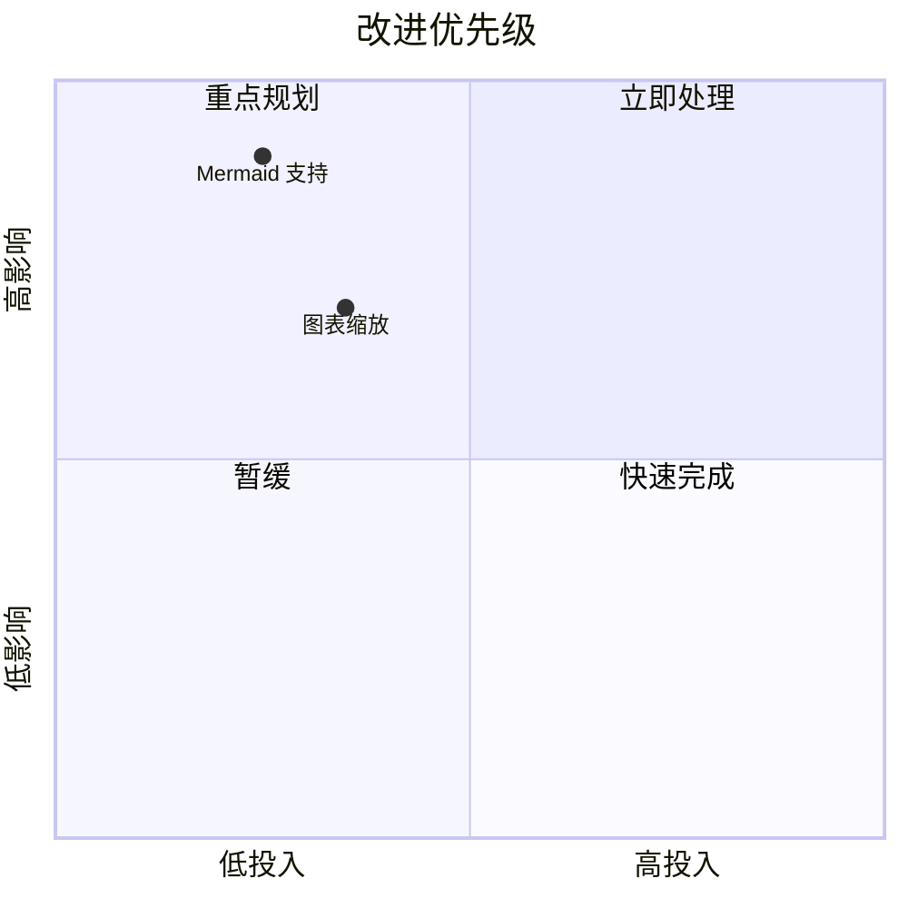

## XY 图

```markdown
xychart
    title "每周访问量"
    x-axis ["周一", "周二", "周三", "周四", "周五"]
    y-axis "访问量" 0 --> 100
    bar [40, 55, 70, 65, 90]
```

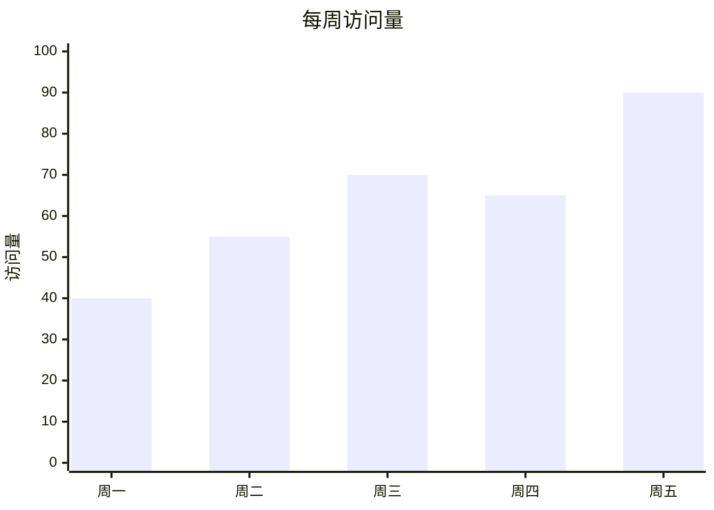

## 需求图

```markdown
requirementDiagram
    requirement publish {
        id: 1
        text: Publish documentation
        risk: low
        verifymethod: test
    }
    element pipeline {
        type: simulation
    }
    pipeline - satisfies -> publish
```

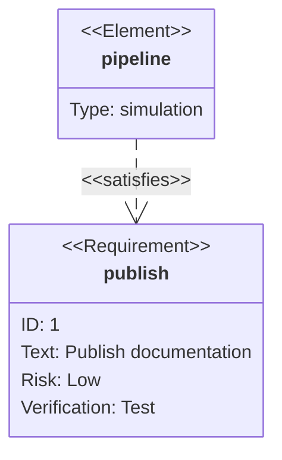

## 桑基图

```markdown
sankey

Markdown,Hugo,80
Markdown,Other,20
```

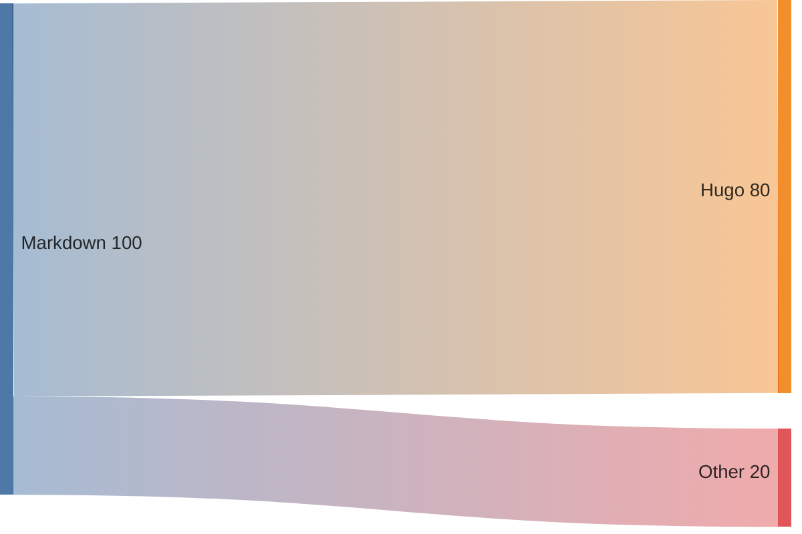

## 架构图

```markdown
architecture-beta
    service web(server)[Web]
    service api(server)[API]
    service db(database)[Database]

    web:R -- L:api
    api:R -- L:db
```

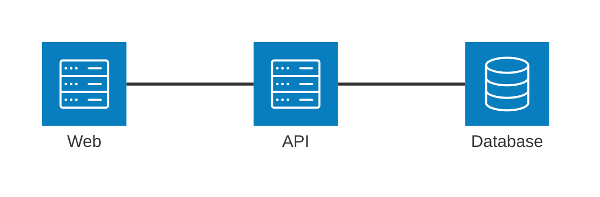

## C4 图

```markdown
C4Context
    title 文档发布系统
    Person(author, "作者", "编写文档")
    System(site, "BookStack", "Hugo 文档站点")
    Rel(author, site, "发布内容")
```

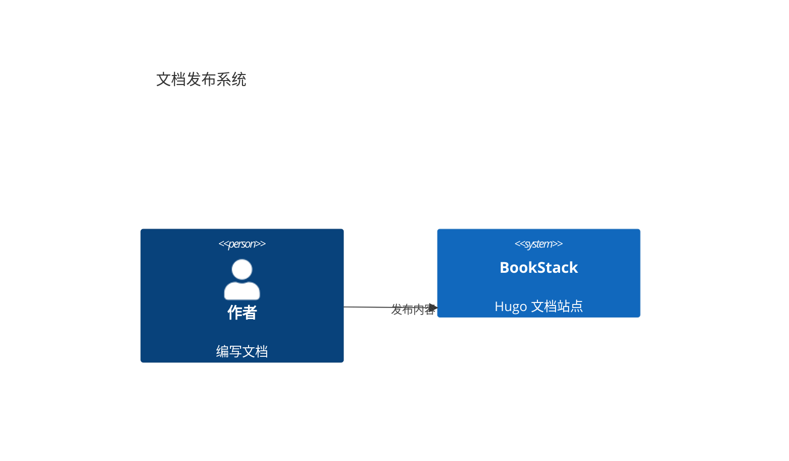

## 块图

```markdown
block-beta
    columns 3
    docs["文档"]:2
    site["站点"]
    docs --> site
```

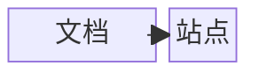

## Agent 流程图

```markdown
agentflow-beta TB
    flow input["输入"]
        request["接收请求"]@{ shape: input }
    end
    flow output["输出"]
        publish["发布结果"]@{ shape: action }
    end

    request --> publish
```

```mermaid
agentflow-beta TB
    flow input["输入"]
        request["接收请求"]@{ shape: input }
    end
    flow output["输出"]
        publish["发布结果"]@{ shape: action }
    end

    request --> publish
```

## 铁路图

```markdown
railroad-ebnf-beta
title 问候语法
greeting = "Hello" name "!" ;
name = "Mermaid" | "Pele" ;
```

```mermaid
railroad-ebnf-beta
title 问候语法
greeting = "Hello" name "!" ;
name = "Mermaid" | "Pele" ;
```

## 树视图

```markdown
treeView-beta
    docs/
        index.md
        diagrams/
            flow.mmd
```

```mermaid
treeView-beta
    docs/
        index.md
        diagrams/
            flow.mmd
```

## Cynefin 图

```markdown
cynefin-beta
    title 工作类型

    clear
        "常规工作"
    complicated
        "分析工作"
    complex
        "探索工作"
    chaotic
        "紧急响应"
```

```mermaid
cynefin-beta
    title 工作类型

    clear
        "常规工作"
    complicated
        "分析工作"
    complex
        "探索工作"
    chaotic
        "紧急响应"
```

## Wardley 地图

```markdown
wardley-beta
title 文档发布链路

anchor Reader [0.95, 0.80]
component Content [0.65, 0.75]
component Renderer [0.40, 0.55]

Reader -> Content
Content -> Renderer
```

```mermaid
wardley-beta
title 文档发布链路

anchor Reader [0.95, 0.80]
component Content [0.65, 0.75]
component Renderer [0.40, 0.55]

Reader -> Content
Content -> Renderer
```

## 事件建模

```markdown
eventmodeling

timeframe 01 ui DocsUI
timeframe 02 command Publish
timeframe 03 event Published
```

```mermaid
eventmodeling

timeframe 01 ui DocsUI
timeframe 02 command Publish
timeframe 03 event Published
```

## 用例图

```markdown
usecase-beta
direction LR
actor Reader
systemBoundary Docs
    View("查看图表")
    Zoom("缩放图表")
end
Reader --> View
Reader --> Zoom
```

```mermaid
usecase-beta
direction LR
actor Reader
systemBoundary Docs
    View("查看图表")
    Zoom("缩放图表")
end
Reader --> View
Reader --> Zoom
```

## 韦恩图

```markdown
venn-beta
    set Content
    set Hugo
    set Pele
    union Content,Hugo["源码"]
    union Hugo,Pele["渲染"]
```

```mermaid
venn-beta
    set Content
    set Hugo
    set Pele
    union Content,Hugo["源码"]
    union Hugo,Pele["渲染"]
```

## 石川图

```markdown
ishikawa-beta
    图表不可见
    Content
        语法错误
    Rendering
        脚本未加载
```

```mermaid
ishikawa-beta
    图表不可见
    Content
        语法错误
    Rendering
        脚本未加载
```

## 数据包图

```markdown
packet
0-7: "Header"
8-15: "Payload"
```

```mermaid
packet
0-7: "Header"
8-15: "Payload"
```

## 雷达图

```markdown
radar-beta
    axis speed["速度"], quality["质量"], cost["成本"]
    curve docs["文档"]{4, 5, 3}
    max 5
```

```mermaid
radar-beta
    axis speed["速度"], quality["质量"], cost["成本"]
    curve docs["文档"]{4, 5, 3}
    max 5
```

## 矩形树图

```markdown
treemap-beta
"内容"
    "文档": 70
    "博客": 30
```

```mermaid
treemap-beta
"内容"
    "文档": 70
    "博客": 30
```

## 信息图

```markdown
info
```

```mermaid
info
```
