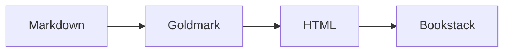

## 图片

## 原生 HTML

  
展开原生 HTML 内容

  这段内容位于 `
` 元素中，用于检查 Goldmark 的 unsafe HTML 渲染。

  - 支持列表
  - 支持 **Markdown 与 HTML 混排**

## Mermaid

## 主题提示块





## 深层的脚注与链接

当前页面位于 `/docs/markdown-test/structured/deep/level-three/leaf/`，可以返回[基础文本页](/docs/markdown-test/basic/text/)继续检查。[^deep]

[^deep]: 如果本脚注显示正常，说明深层页面的 Markdown 解析与普通页面一致。
